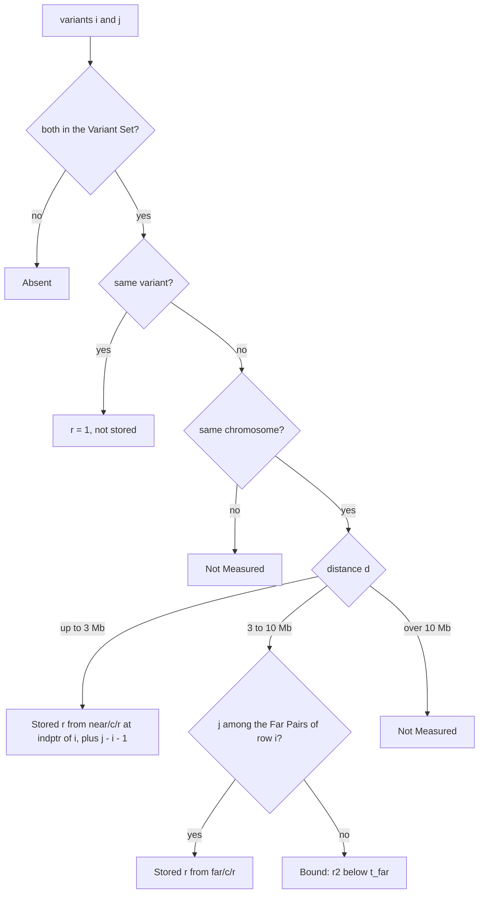

# LD Store Format Specification

Status: draft
Format version described: `0.1.0`

This document defines a valid **LD Store**: the arrays, their dtypes and Zarr layout, how r is
quantised, the provenance an LD Store carries, what a reader answers for a pair, and when it
refuses. The decisions behind it are in ADR 0001
(`docs/adr/0001-near-band-and-thresholded-far-pairs.md`); the terms are in `CONTEXT.md`.
**ALID**, its **A1** and **Reference Assembly** are the engine's (opengwas/opengwasdb `CONTEXT.md`,
_Variant Identity_), not redefined here.

The numbers that chose the layout and the codec come from prototypes run on real HGDP+1kGP
chr22 genotypes. They are on the prototype branch `proto/1-ld-store-layout`, and each is cited as
`proto/1-ld-store-layout@65f94ca:<path>`, so a citation stays fixed if the branch moves.

Normative language:

- **MUST** indicates a requirement for a valid LD Store.
- **SHOULD** indicates a recommended default that implementations may override with documented reason.
- **MAY** indicates an optional feature.


_Figure 1. The pairs an LD Store holds, drawn to scale from the prototype's EUR chr22 slice
(`proto/1-ld-store-layout@65f94ca:prototypes/ld-store-layout/s10_figures.py`). Each pair is stored
once, in the row of its earlier variant. One variant's downstream partners are its row, read in
one piece; its upstream partners are its column, one element in each earlier row (§11)._

## 1. Envelope

An LD Store is one directory holding one Zarr v3 hierarchy, with its group metadata at the root.
Its arrays are written with the `sharding_indexed` codec (§6). There MUST be exactly one LD Store
per (**Source Panel**, **Reference Assembly**) (ADR 0001, decision 1).

```text
<ld store>/                  Zarr v3 group; attribute "ld_store": format version, encoding, provenance (§7)
├── variants/                the Variant Set, one row per variant, in genomic order (§2)
│   ├── position             int32
│   ├── alid                 string (UTF-8)
│   ├── a1                   string (UTF-8)
│   ├── a2                   string (UTF-8)
│   └── a1_frequency         float32
├── near/<chrom>/            the Near Band of one chromosome (§4)
│   ├── indptr               int64, rows + 1
│   └── r                    int16, every row's codes, row after row
└── far/<chrom>/             the Far Pairs of one chromosome (§5)
    ├── indptr               int64, rows + 1
    ├── partner              int32, chromosome-local row of the later variant
    └── r                    int16
```

`<chrom>` is the engine's canonical chromosome label (`1`–`22`, `X`, `Y`, `MT`, no `chr` prefix).
Each chromosome of the Variant Set has its own `near/<chrom>` and `far/<chrom>` groups. The band
never crosses a chromosome, so per-chromosome arrays lose nothing. They also let a builder write
chromosomes in parallel: a Zarr shard is written whole, and no shard can then span two
chromosomes.

An LD Store MUST NOT contain individual-level data (ADR 0001, decision 5): no genotypes, no sample
identifiers, no per-sample values of any kind. A reader ignores any array or group it does not know.

## 2. Variant table (`variants/`)

- Rows MUST be in the engine's variant order: chromosome (`1`–`22`, `X`, `Y`, `MT`), then position
  ascending, then ALID ascending (bytewise) at one position.
- The `variants` group attribute `chromosomes` MUST list, in that order, one
  `{"name": <chrom>, "row_start": int, "row_stop": int}` per chromosome. The ranges are
  contiguous and cover rows `[0, n_variants)`. A row's **chromosome-local row** is its row minus
  its chromosome's `row_start`; `near/` and `far/` use local rows.
- `position` is the 1-based position on the Reference Assembly, `int32`.
- `alid` is the engine's ALID, exactly as the engine's identity function forms it. ogld#3 decides
  whether ogld imports that function or holds a tested copy; this format stores what it forms.
  `a1` and `a2` are the variant's two alleles as the engine's _Variant Identity_ spells them, A1
  first, in full (opengwas/opengwasdb ADR 0017 keeps the full alleles). All three are Zarr v3
  variable-length UTF-8 strings (`string` data type), and none is ever truncated.
- `a1_frequency` is A1's frequency in the Source Panel's samples, after the variant filters,
  `float32`.

**Why ALID is stored this way.** The engine keeps ALID in `variants.tsv.gz` and searches it through
a fixed-width `|S32` sidecar. An ALID wider than 32 bytes is left out of that index and found by
an exact scan over its position (engine issue #127). An LD Store needs no such index: its rows are
in position order. So a reader finds an ALID by parsing its chromosome and position, binary-searching
`position` within the chromosome's row range, and comparing the full ALID strings of the rows at
that position. That is exact at any length, so there is no fixed-width slot, nothing to leave out
and no omission to count. Keeping the strings as Zarr arrays leaves the whole LD Store one Zarr
hierarchy that a client reads over HTTP. The ALID is stored, not derived from the other columns,
so a reader never reimplements identity. Validation checks it against
(`chromosome`, `position`, `a1`, `a2`) with the identity function #3 settles (§12). This needs
no engine change. zarr-python 3.4.1 writes and reads these strings inside sharded arrays (the
prototype's stores,
`proto/1-ld-store-layout@65f94ca:prototypes/ld-store-layout/s05_build_stores.py`). A reader in
another language needs Zarr's variable-length string extension.

A variant outside the Variant Set is **Absent** (§8).

## 3. Orientation and quantisation

**Orientation.** r(i, j) is the correlation, after **PC Adjustment**, of the A1 dosages of
variants i and j, where A1 is each variant's engine A1. A reader that flips one variant's alleles
flips the sign of every r it is in.

**Quantisation.** r is stored as an `int16` code:

```text
code = clamp(rint(r × 32767), −32767, +32767)      rint rounds half to even (IEEE 754, numpy.rint)
r̂    = code / 32767                                 the Stored r a reader gets back
```

| code | meaning |
|---|---|
| −32768 | reserved: never a correlation. It is every r array's fill value, and a valid LD Store holds none |
| −32767 … +32767 | r̂ = code / 32767; r = ±1 is ±32767 exactly |

- The scale is symmetric, so negating a code to flip an allele never overflows, and r = ±1 is
  exact. It is magenpy's `int16` scale (1 / `iinfo(int16).max`). The quantisation error is at most
  1/65534 ≈ 1.53×10⁻⁵ in r.
- **The reserved code is the fill value, so an unwritten chunk can never read as r = 0.** In a
  Zarr array, a chunk that was never written reads as the fill value. With a fill value of 0, a
  build that lost a chunk would hand readers a run of plausible zeros, which ADR 0001 forbids.
  With −32768 the same loss reads as a code that validation (§12) and every reader reject.
- **There is no "undefined" code.** r is undefined only for a variant with no genotype variance
  after PC Adjustment. MAC ≥ 20 does not exclude this: a site where every called sample is
  heterozygous has none. The prototype found 9 such sites in the AFR chr22 slice and 2 each in
  EAS and SAS (`variants_dropped_zero_variance` in
  `proto/1-ld-store-layout@65f94ca:prototypes/ld-store-layout/results/r_AFR.json`,
  `proto/1-ld-store-layout@65f94ca:prototypes/ld-store-layout/results/r_EAS.json` and
  `proto/1-ld-store-layout@65f94ca:prototypes/ld-store-layout/results/r_SAS.json`). A builder
  MUST drop such variants from the Variant Set and count them in provenance (`variants_dropped`,
  §7). Every stored pair then has a defined r, and the answer table (§8) needs no fourth row.
- The scale, dtype, reserved code and rounding are recorded in `encoding` (§7). A reader MUST
  refuse an LD Store whose `encoding` it does not implement.

**Thresholds are judged on the Stored r.** A pair reaches an r² threshold t when r̂² ≥ t,
computed in float64. Every rule below uses this comparison: the builder's Far Pair rule (§5), the
Bound (§8), and clumping and proxies (§9). So a reader's view is self-consistent. But the
computed r and r̂ differ by up to 1.53×10⁻⁵, so a pair whose computed r² lies within about
2|r| × 1.53×10⁻⁵ of a threshold can fall on either side of it. For example, a computed r² of
0.0099994 is stored as code 3277, which reads back as r̂² = 0.0100018 and reaches 0.01 (the
rounding walkthrough of `proto/1-ld-store-layout@65f94ca:prototypes/answer-semantics.html`).
ogld#6 lists any pair like this when it compares clumping with `plink2 --clump`.

**The far code floor.** `far_code_floor` is the smallest integer c ≥ 0 with (c / 32767)² ≥ t_far
in float64. A 3–10 Mb pair is a Far Pair exactly when |code| ≥ `far_code_floor`. It is recorded
in provenance, and validation recomputes it.

**Where a pair at exactly t_far lands.** Such a pair's code is rint(√t_far × 32767). It is a Far
Pair when that reaches the floor, and reads as the Bound when it does not. In true r², the cut
between the two is ((`far_code_floor` − ½) / 32767)². That cut lies within about 2√t_far / 65534 of
t_far, on either side. So a pair whose true r² is up to that much above t_far can read
"r² < t_far" (`proto/1-ld-store-layout@65f94ca:prototypes/ld-store-layout/results/t_far_edge.tsv`):

| LD Store | k | t_far | √t_far × 32767 | far code floor | a pair at exactly t_far | true r² cut |
|---|---|---|---|---|---|---|
| UK Biobank EUR | 0 or 10 | 0.001 | 1036.18 → 1036 | 1037 | **the Bound** | 0.0010006 |
| HGDP+1kGP EUR | 0 | 0.0270649 | 5390.64 → 5391 | 5391 | stored | 0.0270635 |
| HGDP+1kGP EUR | 10 | 0.0274211 | 5425.99 → 5426 | 5426 | stored | 0.0274161 |
| HGDP+1kGP AFR | 0 | 0.0259527 | 5278.71 → 5279 | 5279 | stored | 0.0259506 |
| HGDP+1kGP AFR | 10 | 0.0262799 | 5311.89 → 5312 | 5312 | stored | 0.0262761 |
| HGDP+1kGP EAS | 0 | 0.0255392 | 5236.49 → 5236 | 5237 | **the Bound** | 0.0255393 |
| HGDP+1kGP EAS | 10 | 0.0258561 | 5268.88 → 5269 | 5269 | stored | 0.0258524 |
| HGDP+1kGP SAS | 0 | 0.0266496 | 5349.12 → 5349 | 5350 | **the Bound** | 0.0266534 |
| HGDP+1kGP SAS | 10 | 0.0269948 | 5383.65 → 5384 | 5384 | stored | 0.0269933 |
| HGDP+1kGP AMR | 0 | 0.0605814 | 8065.04 → 8065 | 8066 | **the Bound** | 0.0605884 |
| HGDP+1kGP AMR | 10 | 0.0623952 | 8184.88 → 8185 | 8185 | stored | 0.0623894 |

At k = 10, the default, a pair at exactly t_far is a Far Pair on every HGDP+1kGP panel, and so
is a pair a little below it, down to the cut. On UK Biobank EUR it reads as the Bound: a true r²
up to 0.0010006 reads "r² < 0.001". The walkthrough "A pair at exactly t_far" in
`proto/1-ld-store-layout@65f94ca:prototypes/answer-semantics.html` steps through these cases.

## 4. Near Band (`near/<chrom>/`)

For chromosome c with n_c rows, local rows l = 0 … n_c − 1 and positions p_l:

- The **distance** of a pair is d = p_m − p_l in base pairs, m > l, on one chromosome. Two
  variants at one position (d = 0, such as the records of a split multi-allelic site) are a pair.
- Each pair is stored once, in the row of its earlier variant: row l holds every m > l with
  d ≤ 3,000,000, in ascending m. Its length is len_l = |{m > l : p_m − p_l ≤ 3,000,000}|. A row
  stops at its chromosome's last variant.
- `indptr` has n_c + 1 entries: indptr[0] = 0 and indptr[l + 1] = indptr[l] + len_l.
- `r` holds the rows back to back: r(l, m) is at `r[indptr[l] + (m − l − 1)]`.
- Columns are implicit, so there is no column array. `indptr` can be derived from `position`. It
  is stored so a reader needs no position scan, and validation checks it against the positions (§12).
- The diagonal, r(l, l) = 1, is not stored.
- With k = 0, the Near Band is the unadjusted r that `plink2 --r-unphased` computes, to within the
  quantisation step; ogld#5 tests that equivalence.

`indptr` is `int64` because one chromosome's band exceeds 2³¹ codes. AFR chr2 at MAC ≥ 20 holds
about 3.7×10¹⁰ (`largest_chromosome_mac20` in
`proto/1-ld-store-layout@65f94ca:prototypes/ld-store-layout/results/s08_meta.json`).

## 5. Far Pairs (`far/<chrom>/`)

- (l, m) is a Far Pair when m > l, 3,000,000 < d ≤ 10,000,000 and |code(l, m)| ≥ `far_code_floor`.
- `indptr` (`int64`, n_c + 1 entries) delimits row l's Far Pairs. `partner` holds their local rows m,
  strictly ascending within a row. `r` holds their codes.
- `partner` is `int32`: the largest chromosome's Variant Set at MAC ≥ 20 is about 1.7×10⁶ rows
  (AFR chr2, the same `proto/1-ld-store-layout@65f94ca:prototypes/ld-store-layout/results/s08_meta.json`), far inside 2³¹.
- Each Far Pair is stored once, in its earlier variant's row, as in the Near Band. **This is
  open** for both components (§11).

A 3–10 Mb pair that is not a Far Pair has r̂² < t_far: its answer is the **Bound** (§8). At k = 0,
9.4×10⁻⁵ (EUR) to 2.3×10⁻³ (AMR) of chr22's 3–10 Mb pairs are Far Pairs
(`proto/1-ld-store-layout@65f94ca:prototypes/ld-store-layout/results/panel_sizes_inner262144.tsv`).

## 6. Physical layout

Every array is Zarr v3 with `sharding_indexed`. Inside a shard, each kind of array has one codec
chain. The shard index is `bytes` then `crc32c`, at the end of the shard (zarr-python's default).

| array kind | codecs inside the shard |
|---|---|
| numeric: `position`, `a1_frequency`, every `indptr`, `r` and `partner` | `bytes` (little-endian), then `zstd` level 3 |
| string: `alid`, `a1`, `a2` | `vlen-utf8`, then `zstd` level 0, which zstd reads as its default level, 3 (zarr-python's default for strings, and what the prototype's stores used) |

A shard MUST be a whole multiple of its inner chunk. An array shorter than its shard has one
shard, clipped to the smallest whole number of inner chunks that covers it, as in the engine's
spec §10a. An inner chunk longer than its array is clipped to the array.

| array | dtype | shape | inner chunk | shard | fill value |
|---|---|---|---|---|---|
| `variants/position` | `int32` | (V,) | 16,384 | 1,048,576 | 0 |
| `variants/alid`, `a1`, `a2` | `string` | (V,) | 16,384 | 1,048,576 | `""` |
| `variants/a1_frequency` | `float32` | (V,) | 16,384 | 1,048,576 | NaN |
| `near/<chrom>/indptr` | `int64` | (n_c + 1,) | 16,384 | 1,048,576 | −1 |
| `near/<chrom>/r` | `int16` | (indptr[n_c],) | **262,144**, provisional | **67,108,864**, provisional | −32768 |
| `far/<chrom>/indptr` | `int64` | (n_c + 1,) | 16,384 | 1,048,576 | −1 |
| `far/<chrom>/partner` | `int32` | (far_c,) | 16,384 | 1,048,576 | −1 |
| `far/<chrom>/r` | `int16` | (far_c,) | 16,384 | 1,048,576 | −32768 |

V is the Variant Set's size, n_c a chromosome's rows and far_c its Far Pairs. Every fill value is
one a valid LD Store never holds, so a chunk that was never written cannot read as data. This
table describes how a builder writes an LD Store. Each array's own Zarr metadata records its
chunk, shard and codecs, and readers MUST NOT depend on them: a store re-sharded for serving
(ogld#9) reads the same. Validation checks only that every `r` array's fill value is −32768 (§12).

**Why zstd level 3.** int16 r codes are mostly sampling noise around 0, so they compress little,
and the codec was chosen on measured ratio and speed. These are the measurements on EUR chr22's
real Near Band, by inner chunk (elements). Speeds are per core, in MB/s of raw data
(`proto/1-ld-store-layout@65f94ca:prototypes/ld-store-layout/results/codec_table.md`, rendered
from `proto/1-ld-store-layout@65f94ca:prototypes/ld-store-layout/results/codecs_EUR.tsv`):

| codec | ratio, 4,096 | ratio, 32,768 | ratio, 262,144 | encode MB/s, 32,768 | decode MB/s, 32,768 |
|---|---|---|---|---|---|
| zstd 3 | 1.147 | 1.161 | 1.205 | 634 | 807 |
| Blosc zstd 3, byte shuffle | 1.140 | 1.169 | 1.186 | 276 | 654 |
| Blosc zstd 3, bitshuffle (the engine's chain) | 1.213 | 1.076 | 1.007 | 608 | 1,513 |
| Blosc zstd 9, bitshuffle | 1.250 | 1.261 | 1.280 | 8 | 1,137 |
| delta, then Blosc zstd 3, bitshuffle | 1.158 | 1.046 | 1.006 | 428 | 561 |

- The engine's chain, Blosc zstd 3 with bitshuffle, nearly stops compressing at inner chunks of
  32,768 elements and above.
- At 262,144, Blosc zstd 9 with bitshuffle gains 6.2% over zstd 3 (1.280 against 1.205), but
  encodes at 8 MB/s per core against 634.
- A delta filter makes things worse, because neighbouring codes in a row are mostly independent
  noise.
- The other panels agree. zstd 3 at 262,144 gives 1.165 (AFR), 1.199 (EAS), 1.200 (SAS) and
  1.198 (AMR)
  (`proto/1-ld-store-layout@65f94ca:prototypes/ld-store-layout/results/codecs_AFR_EAS_SAS_AMR.tsv`,
  `proto/1-ld-store-layout@65f94ca:prototypes/ld-store-layout/results/codecs_EAS_SAS_AMR_inner262144.tsv`).
- On the Far Pairs' arrays, zstd 3 gives 3.47× on `partner`, 1.40× on `r` and 3.23× on `indptr`.

**Why these chunk and shard shapes.** The prototype timed three layouts of the Near Band
(§10), as (inner chunk, shard) in codes: A (4,096, 4,194,304), B (32,768, 16,777,216) and C
(262,144, 67,108,864).

- **A is ruled out.** A 3 Mb LD matrix took 21 s from local disk, against 3.7 s for B and 2.0 s
  for C.
- **C is faster on reads that span many chunks, most of all once each request costs time.**
  With 20 ms added per request, C took:
  - 2.2× less time than B on the 3 Mb matrix (4.21 s against 9.34 s, one run of the largest
    region);
  - 3.0× less on 500 scattered variants (0.54 s against 1.62 s);
  - 4.0× less on a variant's upstream column (0.99 s against 4.01 s).

  From local disk, C decoded that column 8.0× faster (0.39 s against 3.13 s) and the matrix 1.8×
  faster. Without added latency the scattered read is close: 0.31 s against 0.36 s from local
  disk, and 0.63 s against 0.59 s over HTTP.
- **B wins only on single-chunk reads, and on bytes.** From local disk a single pair took 5.2 ms on B
  and 7.5 ms on C. B read 7.0× fewer bytes for it (0.066 MB against 0.46 MB), and 2.5× fewer for
  500 scattered variants (109 MB against 272 MB). On localhost, bandwidth is not a limit. So these
  runs do not show what those bytes cost a client on a slow link.
- **C's Near Band is 3.9% smaller** on the slice (1,583 MB against 1,648 MB) and was written 4.6×
  faster (2.7 s against 12.4 s)
  (`proto/1-ld-store-layout@65f94ca:prototypes/ld-store-layout/results/stores.json`).

**The layout is C, provisionally.** Two results could change it:

- **§11's decision.** If the outline stays, a column read decides `proxies()`, and C decodes it
  8× faster, which confirms C. If a symmetric band or a proxy index removes the column read, C
  loses its largest lead. What remains is C's faster multi-chunk reads against B's 2.5–7× fewer
  bytes on small reads.
- **ogld#8's latency measurements over a real network.** Suppose the clients reading static Zarr,
  an option for ogld#9, are limited by bandwidth rather than by requests. Then B's fewer bytes
  could outweigh C's lead.

A C shard is 256 inner chunks: 128 MiB raw, about 106 MiB on disk. That is about 2,800 files for
HGDP+1kGP EUR's Near Band, and 7,200 for AFR's. The other arrays use one shape, 16,384 inner and
1,048,576 to a shard. These arrays are read whole or by row range, and the prototype's stores used
this shape for them.

**Sizes.** On the provisional layout, with MAC ≥ 20 and the Far Pairs measured at k = 0
(`proto/1-ld-store-layout@65f94ca:prototypes/ld-store-layout/results/panel_sizes_inner262144.tsv`):

| LD Store | variants | Near Band pairs | Near Band | Far Pairs | total |
|---|---|---|---|---|---|
| HGDP+1kGP EUR | 12.9 M | 1.86×10¹¹ | 308 GB | 0.09 GB | 308 GB |
| HGDP+1kGP AFR | 20.9 M | 4.83×10¹¹ | 829 GB | 1.36 GB | 830 GB |
| HGDP+1kGP EAS | 11.9 M | 1.58×10¹¹ | 263 GB | 0.15 GB | 263 GB |
| HGDP+1kGP SAS | 13.2 M | 1.95×10¹¹ | 325 GB | 0.16 GB | 325 GB |
| HGDP+1kGP AMR | 9.8 M | 1.09×10¹¹ | 182 GB | 1.39 GB | 183 GB |

AMR is measured genome-wide. EUR, AFR, EAS and SAS scale each chromosome's measured MAC ≥ 50
counts by chr22's measured MAC ≥ 20 / MAC ≥ 50 ratio. On layout B's 32,768 chunk, each Near Band
is 1.5–7.4% larger
(`proto/1-ld-store-layout@65f94ca:prototypes/ld-store-layout/results/panel_sizes_inner32768.tsv`).

**UK Biobank EUR's size is ogld#10's measurement.** No UK Biobank genotype was read for this
spec. At n = 49,766, MAC ≥ 20 is MAF ≥ 2.0×10⁻⁴. The only UK Biobank variant list under
`/data/opengwasdb/reference/` on the IEU compute nodes is the engine's UK Biobank EUR LD Reference
Panel's: 9.8 M variants, all with MAF ≥ 0.005
(`proto/1-ld-store-layout@65f94ca:prototypes/ld-store-layout/results/ukb_panel_list_maf.json`).
That list is a subset of the MAC ≥ 20 set and cannot count it.

- On that list alone, the Near Band would hold 1.10×10¹¹ pairs, or 182 GB.
- Near Band bytes grow with variants × partners per row, so roughly with the square of variant
  density. Twice the list's variants gives about 729 GB, and three times gives 1.64 TB
  (`proto/1-ld-store-layout@65f94ca:prototypes/ld-store-layout/results/panel_sizes_inner262144.tsv`).
- The Far Pairs at t_far = 0.001 cannot be measured at n = 771. There, the mean r² at 3–10 Mb
  (0.0012945) is no higher than sampling alone predicts (1/n = 0.0012970;
  `proto/1-ld-store-layout@65f94ca:prototypes/ld-store-layout/results/s08_meta.json`). At an assumed 1–5% of 3–10 Mb pairs, the list's Far Pairs would be 6–30 GB.

## 7. Provenance

The root group attribute `ld_store` is a JSON object. Every key below is REQUIRED, with the type
shown. Other keys MAY appear, and a reader ignores the ones it does not know.

| key | type | meaning |
|---|---|---|
| `format_version` | string | `"0.1.0"` |
| `encoding.r_dtype` | string | `"int16"` |
| `encoding.r_scale` | int | 32767: r̂ = code / r_scale |
| `encoding.r_reserved_code` | int | −32768 |
| `encoding.rounding` | string | `"half_to_even"` |
| `panel.id` | string | the Source Panel's identifier, such as `"hgdp1kgp-gnomad-v3.1.2-EUR"` |
| `panel.ancestry` | string | the ancestry label, such as `"EUR"` |
| `panel.n` | int | samples the LD was computed from |
| `panel.samples_sha256` | string | SHA-256 of the sorted sample identifiers, one per line. The identifiers themselves stay with the Source Panel |
| `panel.genotype_source` | string | the genotype input, such as the gnomAD release and its files |
| `panel.genotype_sha256` | object | SHA-256 per genotype input file |
| `reference_assembly` | string | the engine's Reference Assembly, such as `"GRCh38"` |
| `variant_filters` | object | every filter and its value: `mac_min` (int, default 20), `info_min` (float or null; 0.8 for an imputed panel), `max_alleles` (int), and any other the build applied |
| `variants_dropped` | object | count per reason a variant passing the filters was dropped: at least `zero_variance` (int) |
| `n_variants` | int | rows of `variants/` |
| `near_bp` | int | 3000000 |
| `far_bp` | int | 10000000 |
| `pc_adjustment.k` | int | PCs regressed out; 0 for unadjusted LD |
| `pc_adjustment.method` | string | the PCA, such as `"plink2 --pca approx"` |
| `pc_adjustment.pruning` | object | LD pruning of the PC variants: window, step, r², `maf_min` (default 0.05) |
| `pc_adjustment.excluded_regions` | object | `source` (citations), `version`, `assembly`, `sha256` and `n_regions` of the Long-Range LD Regions list; see below |
| `pc_adjustment.n_pc_variants` | int | variants the PCs were computed from |
| `t_far` | float | max(0.001, q / (n − k − 1)) in float64, the value every reader uses |
| `t_far_q` | float | 20.84: the χ²₁ upper quantile at p = 5×10⁻⁶ |
| `far_code_floor` | int | §3 |
| `pc_diagnostic.pairs` | object | the pair set: `source` (opengwas/opengwasdb#405's seeded cross-chromosome pairs), `seed` (405), `n_pairs` (200,000) |
| `pc_diagnostic.rate_r2_ge_0_01_unadjusted` | float | share of those pairs with r² ≥ 0.01 at k = 0 |
| `pc_diagnostic.rate_r2_ge_0_01_adjusted` | float | the same share after PC Adjustment |
| `pc_diagnostic.rate_r2_ge_0_01_sampling` | float | the share sampling alone predicts, P(χ²₁ ≥ 0.01 × (n − k − 1)) |
| `pc_diagnostic.near_100kb_change` | object | quantiles (0, 0.5, 0.9, 0.99, 1) of the change in r from adjustment, for pairs within 100 kb outside the excluded regions (#5's "real LD survives") |
| `counts.near_pairs` | int | Near Band codes, over all chromosomes |
| `counts.far_candidates` | int | 3–10 Mb pairs examined |
| `counts.far_pairs` | int | Far Pairs kept |
| `software` | object | versions: `ogld`, `plink2`, `numpy`, `zarr` |
| `build.created_at` | string | ISO 8601 UTC |
| `build.wall_seconds` | float | build time |
| `build.peak_memory_bytes` | int | peak memory |
| `build.threads` | int | threads used |

The provenance holds counts, hashes and settings, never a sample identifier or a per-sample value.

**The excluded regions: a recommendation to ogld#5.** No list of Long-Range LD Regions is under
`/data/opengwasdb/reference/` on the IEU compute nodes. `ld_regions_hg38.tsv` there is the engine's
LD block partition, a different list. ogld#5 asks for "a published GRCh38 list". This spec found
none it could recommend, and recommends ogld's own derivation of a published GRCh37 list instead.
#5 decides.

- **The list.** The 24 regions of Price et al. (2008, _Am J Hum Genet_ 83:132) and Weale (2010), as
  Anderson et al. (2010, _Nat Protoc_ 5:1564) tabulate them in GRCh37. They cover the MHC
  (chr6:25–35 Mb in GRCh37) and the 8p23 inversion (chr8:7–13 Mb).
- **Lifting it.** Each region's two endpoints are lifted to GRCh38 with UCSC liftOver
  (`hg19ToHg38` chain), so a region is never broken into fragments.
- **17q21.31.** The 24 do not include the 17q21.31 inversion, which #5 also requires, so #5 adds it
  and names its source.
- **Not plinkQC's GRCh38 file.** The widely copied `high-LD-regions-hg38-GRCh38.txt` in plinkQC,
  also the GRCh38 table on the University of Michigan's Genome Wiki page "Regions of high linkage
  disequilibrium (LD)", is a fragmentary liftover. Its only chr17 entry is 33 bp long. GRCh37's
  chr2:134.5–138 Mb becomes 119 bp, and GRCh37's chr3:89–97.5, chr5:98–100.5 and chr11:46–57 Mb
  are missing (both tables read on 7 November 2026).

#5 records the citations, the derived list's SHA-256 and the 17q21.31 source in
`pc_adjustment.excluded_regions`.

## 8. Pair answers

The **Pair Answer** for variants i and j:

| distance | answer |
|---|---|
| ≤ 3 Mb | the exact r: the Stored r, from the Near Band |
| 3–10 Mb | the Stored r if the pair is a Far Pair (r̂² ≥ t_far); otherwise the **Bound** "r² < t_far", never a stored 0 |
| > 10 Mb | **Not Measured** |

The boundaries, exactly:

- d ≤ 3,000,000 bp is the Near Band; 3,000,000 < d ≤ 10,000,000 is the Far Pairs; d > 10,000,000 is Not Measured.
- Variants on different chromosomes are Not Measured.
- A variant with itself is r = 1, not stored.
- A variant outside the Variant Set is **Absent**, and so is every pair it is in. A reader MUST say
  which variants are Absent, distinct from pairs that are Not Measured.
- The Bound states t_far, the value recorded in provenance. It is judged on the Stored r: it
  means r̂² < t_far. So a pair whose true r² is up to about 2√t_far / 65534 above t_far can read as
  the Bound. On UK Biobank EUR, a true r² up to 0.0010006 reads "r² < 0.001" (§3).



_Figure 2. How a reader resolves one pair, with i the earlier variant._

A reader MUST return each pair as its answer kind: Stored r, Bound, Not Measured or Absent. A
reader that returns a plain numeric matrix MUST refuse when any requested pair is anything but a
Stored r. It MUST NOT fill a 0, NaN or any other number in its place (ADR 0001; ogld#4).

## 9. Refusals

`clump(variants, score, r2, kb)` and `proxies(variant, r2, kb)` consider the pairs with d ≤ W, where
W = kb × 1,000 bp. A pair reaches the threshold when r̂² ≥ r2 (§3).

| request | answer |
|---|---|
| r2 outside [0, 1], or kb < 0 | refused: invalid |
| W > 10,000,000 | refused: pairs more than 10 Mb apart are Not Measured |
| 3,000,000 < W ≤ 10,000,000 and r2 < t_far | refused: the store holds only the Bound for the 3–10 Mb pairs that are not Far Pairs, and that does not decide r̂² ≥ r2 |
| 3,000,000 < W ≤ 10,000,000 and r2 ≥ t_far | answered from the Near Band and the Far Pairs. Every 3–10 Mb pair left out has r̂² < t_far ≤ r2, so none of them can reach r2 |
| W ≤ 3,000,000 | answered from the Near Band alone, at any r2 |

- r2 = t_far exactly is answered: the store keeps r̂² ≥ t_far, and the request asks for
  r̂² ≥ t_far.
- A request is compared with the recorded `t_far`, never with a rounded display of it.
- A Refusal MUST name its reason. A request MUST NOT be answered approximately instead.
- On UK Biobank EUR (t_far = 0.001) only W > 10 Mb is refused at r2 ≥ 0.001. On HGDP+1kGP AMR
  (t_far 0.062 at k = 10), r2 = 0.05 with a 5 Mb window is refused.
- Whether `plink2 --clump` compares r² with ≥ or >, and the window with ≤ or <, is ogld#6's to
  check. #6 records any difference beside its equality test.

`proto/1-ld-store-layout@65f94ca:prototypes/answer-semantics.html` drives these rules and the
answer table interactively, with walkthroughs of the edge cases: exactly 3 Mb, exactly 10 Mb, r²
equal to t_far, rounding onto a threshold, AMR's t_far, a pair at exactly t_far, and a window over
10 Mb.

## 10. Reads

_Informative._ A reader keeps a chromosome's `position` range and its two `indptr` arrays once it
has opened that chromosome. For all of HGDP+1kGP EUR that is 51 MB of positions and 206 MB of
`indptr`, raw. The reads map onto the arrays as follows.

| read | arrays it touches |
|---|---|
| a row range (an LD matrix of a region) | one contiguous slice of `near/<c>/r`, `indptr[a] … indptr[b]`; it includes each row's partners past the range |
| single rows (a variant's downstream partners) | one contiguous slice per row |
| a submatrix for any variant list | one element of `near/<c>/r` per pair ≤ 3 Mb; the Far Pairs rows of the listed variants |
| a single pair | one element, one inner chunk |
| a whole column (a variant's upstream partners) | one element in each row of the preceding 3 Mb: §11 |

The prototype timed each read on the EUR chr22 slice, a real Zarr v3 sharded LD Store (1.65 GB,
65,035 variants), under the three layouts of §6. It read from local disk, and over HTTP from a
static server that honours Range requests
(`proto/1-ld-store-layout@65f94ca:prototypes/ld-store-layout/results/access_tables.md`, rendered
from `proto/1-ld-store-layout@65f94ca:prototypes/ld-store-layout/results/access_summary.tsv`).

Medians of 3 runs (10 for a single pair), seconds and MB read. Layouts as (inner chunk, shard) in
codes: A (4,096, 4,194,304), B (32,768, 16,777,216), C (262,144, 67,108,864). Local cold: the
store's pages evicted before each run. HTTP: a static Range-serving server on localhost; +20 ms adds
a 20 ms wait per request. zarr 3.4.1, async concurrency 10. Load average 36.02, 39.58, 42.35 at the
start, 37.32, 37.61, 39.87 at the end.

| read | local cold A | local cold B | local cold C | HTTP cold A | HTTP cold B | HTTP cold C | HTTP +20 ms A | HTTP +20 ms B | HTTP +20 ms C | MB read A / B / C | HTTP requests A / B / C |
|---|---|---|---|---|---|---|---|---|---|---|---|
| 3 Mb LD matrix (row range) ¹ | 21.06 s | 3.70 s | 2.02 s | 21.60 s | 4.19 s | 2.22 s | 32.16 s | 9.34 s | 4.21 s | 432 / 425 / 403 | 62 / 19 / 14 |
| 500 scattered variants | 993 ms | 360 ms | 310 ms | 1.80 s | 594 ms | 631 ms | 2.28 s | 1.62 s | 539 ms | 84 / 109 / 272 | 556 / 402 / 313 |
| clump one region's hits | 49 ms | 38 ms | 26 ms | 66 ms | 47 ms | 35 ms | 94 ms | 85 ms | 69 ms | 9.6 / 9.6 / 9.9 | 5 / 3 / 2 |
| single pair | 5.3 ms | 5.2 ms | 7.5 ms | 8.2 ms | 7.4 ms | 10 ms | 48 ms | 48 ms | 51 ms | 0.024 / 0.066 / 0.460 | 2 / 2 / 2 |
| proxies, downstream half | 6.5 ms | 5.1 ms | 5.8 ms | 8.5 ms | 7.3 ms | 8.9 ms | 50 ms | 47 ms | 49 ms | 0.045 / 0.066 / 0.391 | 2 / 2 / 2 |
| proxies, upstream half | 5.79 s | 3.13 s | 392 ms | 7.22 s | 3.70 s | 971 ms | 5.03 s | 4.01 s | 991 ms | 661 / 659 / 638 | 184 / 27 / 15 |
| upstream Far Pairs | 11 ms | 9.9 ms | 12 ms | 14 ms | 15 ms | 16 ms | 99 ms | 100 ms | 99 ms | 0.147 / 0.147 / 0.147 | 4 / 4 / 4 |

¹ HTTP +20 ms ran the matrix once, on the largest of the three regions (21–24 Mb, 700 MB read); HTTP
cold on that region took A 34.25 s, B 10.92 s, C 3.86 s.

- The 3 Mb matrix reads its rows whole, including partners past the region. So it reads about
  twice the codes the matrix needs: 268–700 MB per region, depending on the region's density.
- Clumping a region's hits is a 10 MB submatrix read, 26–49 ms locally. The hits are 97–173
  variants within 1.5 Mb of a lead, at r² ≥ 0.05 to it.
- With 20 ms added per request, the small reads take about 40 ms longer. zarr-python merges
  neighbouring byte ranges in a shard, so even the scattered reads make tens to hundreds of
  requests, not thousands.
- Opening the slice's store (positions and `indptr`, 0.38 MB) took 26–43 ms locally and
  0.04–0.38 s over HTTP
  (`proto/1-ld-store-layout@65f94ca:prototypes/ld-store-layout/results/access_open.tsv`).

## 11. Open: the upstream half

**This section is open. It awaits the owner's decision (ogld#2), and the format above does not
change until then.**

ADR 0001's Near Band stores row i as r(i, i+1 … the last variant ≤ 3 Mb away): the upper
triangle. So a variant's upstream partners, the ones before it, are scattered one per row across
every row in the preceding 3 Mb: about 16,000 rows in the EUR slice. The Far Pairs, stored the same way,
scatter in the same manner over the preceding 3–10 Mb. Anything that needs a whole column pays for
this: `proxies()` first, and any per-variant sum over partners.

The prototype measured the column read and two alternatives on EUR chr22
(`proto/1-ld-store-layout@65f94ca:prototypes/ld-store-layout/results/stores.json` for the sizes,
and `proto/1-ld-store-layout@65f94ca:prototypes/ld-store-layout/results/access_tables.md` for the times):

- **the outline (upper triangle)**, as decided;
- **a symmetric band**: row i holds its upstream partners, then its downstream ones, so a column
  is a row. Near Band bytes ×2.0: 3.33 GB against 1.65 GB on the slice;
- **a sparse symmetric proxy index**: per variant, every partner within 10 Mb on either side with
  r̂² ≥ t_far. It answers `proxies(r2 ≥ t_far)` with one row, and adds 5.2% to the slice's bytes
  (85 MB against 1,648 MB). A proxies request at r2 below t_far still reads the column.

These were measured on layout B:

| proxies for one variant, within 3 Mb | local cold | local warm | HTTP cold | HTTP +20 ms | MB read | HTTP requests |
|---|---|---|---|---|---|---|
| outline: the row (downstream half) | 5.1 ms | 2.2 ms | 7.3 ms | 47 ms | 0.066 | 2 |
| outline: the column (upstream half) | 3.13 s | 3.28 s | 3.70 s | 4.01 s | 659 | 27 |
| symmetric band: one row, both halves | 5.6 ms | 3.8 ms | 7.1 ms | 50 ms | 0.122 | 2 |
| proxy index, r² ≥ t_far: one row, both halves, ≤ 10 Mb | 9.7 ms | 4.8 ms | 12 ms | 97 ms | 0.045 | 4 |

The column is the problem. On layout B one variant's upstream half reads 659 MB and takes 3.1 s,
against 0.066 MB and 5 ms for its downstream half. It costs the same warm as cold, so the time
goes in decoding, not disk. zarr-python merges the scattered byte ranges into large requests, so
the read spans the whole band of the preceding 3 Mb. On the provisional layout C the same column
decodes in 0.39 s but still reads 638 MB. Over a network, every `proxies()` call would move about
640–660 MB. The upstream Far Pairs cost little (0.15 MB, 10–16 ms), because they are sparse.

Genome-wide, at the Near Band and Far Pair densities measured at k = 0, on layout C
(`proto/1-ld-store-layout@65f94ca:prototypes/ld-store-layout/results/upstream_alternatives_sizes_inner262144.tsv`):

| LD Store | Near Band | symmetric band adds | proxy index adds |
|---|---|---|---|
| HGDP+1kGP EUR | 308 GB | 308 GB (+100%) | 15.5 GB (+5.0%) |
| HGDP+1kGP AFR | 829 GB | 829 GB (+100%) | 25.7 GB (+3.1%) |
| HGDP+1kGP EAS | 263 GB | 263 GB (+100%) | 11.3 GB (+4.3%) |
| HGDP+1kGP SAS | 325 GB | 325 GB (+100%) | 13.2 GB (+4.1%) |
| HGDP+1kGP AMR | 182 GB | 182 GB (+100%) | 15.8 GB (+8.7%) |

The proxy index above holds pairs at r̂² ≥ t_far. A higher threshold, such as the r² ≥ 0.8 of a
typical MR proxy search, would be smaller still, but would then answer fewer requests. Neither
alternative changes the per-pair answers (§8) or the refusals (§9); each adds a way to read a
column.

**Decision needed (ogld#2):** keep the outline and accept the column read; or change the Near
Band to a symmetric band; or add a proxy index beside it. Until the owner decides, §1–§9 stand as
written and a builder writes the outline only. The decision also bears on the Near Band's chunk
shape (§6).

## 12. Validation rules

Each rule runs on write and on demand, by name. A rule reads in bounded windows and never loads a
whole Near Band. A rule fails a store when any target breaks it.

| rule | checks |
|---|---|
| `envelope.arrays` | the hierarchy is Zarr v3, and every §1 array exists with its §1 dtype and the length §2, §4 and §5 give it |
| `envelope.fill` | the fill value of every `r` array is −32768, so an unwritten chunk can never read as r = 0 |
| `provenance.complete` | every §7 key is present with its type; other keys are allowed |
| `provenance.encoding` | `encoding` is exactly §3's: a reader refuses any other before decoding |
| `variants.chromosomes` | the `chromosomes` ranges are in chromosome order, contiguous and cover every row |
| `variants.order` | positions ascend within each chromosome, ties broken by ALID ascending, with no repeated ALID |
| `variants.identity` | each `alid` is the identity function's ALID for its chromosome, position, `a1` and `a2` (ogld#3) |
| `variants.frequency` | every `a1_frequency` is finite and in (0, 1) |
| `near.rows` | `indptr` starts at 0 and has n_c + 1 entries; each row's length equals the count of later variants within 3 Mb from `position`. So rows are contiguous and stay within 3 Mb |
| `near.codes` | no code is −32768, so \|r̂\| ≤ 1 holds after dequantisation |
| `far.rows` | `indptr` starts at 0, has n_c + 1 entries and ends at the length of `partner` and `r`; within a row partners are strictly ascending, greater than the row, and lie on the same chromosome |
| `far.distance` | every Far Pair lies more than 3,000,000 and at most 10,000,000 bp apart |
| `far.threshold` | `t_far` equals max(0.001, q / (n − k − 1)) recomputed from provenance, n − k − 1 > q (so t_far < 1), `far_code_floor` equals its recomputed value, and every Far Pair's \|code\| ≥ `far_code_floor` |
| `far.codes` | no code is −32768 |

No rule checks chunk shapes, shards, codecs or the fill value of a non-`r` array (§6). ogld#4
implements these rules, each with a test whose store breaks it.

## 13. Compatibility

`format_version` is `MAJOR.MINOR.PATCH`. A reader MUST refuse a `format_version` or an `encoding`
it does not implement, naming the version, rather than decode it. A change to any array's dtype,
encoding or meaning, or to §8's answers, is a new format version. Settling §11 is one. A change
of chunk or shard shape is not.
