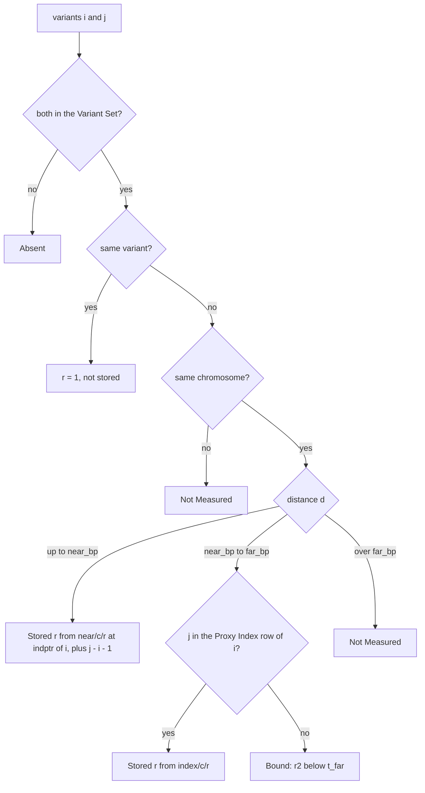

# LD Store Format Specification

Status: draft
Format version described: `0.1.0`

This document defines a valid **LD Store**: the arrays, their dtypes and Zarr layout, how r is
quantised, the provenance an LD Store carries, what a reader answers for a pair, what the four
queries return, and when a request is refused. The decisions behind it are in ADR 0001
(`docs/adr/0001-near-band-and-thresholded-far-pairs.md`), including its clarification of
7 November 2026; the build inputs are in `docs/spec/build-inputs.md` (ADR 0002); the terms are in
`CONTEXT.md`. **ALID**, its **A1** and **Reference Assembly** are the engine's
(opengwas/opengwasdb `CONTEXT.md`, _Variant Identity_), not redefined here. The engine's glossary
says an ALID is formed after "upper-casing, trimming and left alignment"; its code at `1ab2b09`
only upper-cases, requires A, C, G, T and sorts the two alleles, and so does ogld (ADR 0003).

The numbers that chose the layout and the codec come from prototypes run on real HGDP+1kGP
chr22 genotypes. They are on the prototype branch `proto/1-ld-store-layout`, and each is cited as
`proto/1-ld-store-layout@65f94ca:<path>`, so a citation stays fixed if the branch moves.

The semantics of §3, §8 and §9 are implemented in `ogld/format/`, and `tests/test_format.py`
holds that code to this document's tables.

Normative language:

- **MUST** indicates a requirement for a valid LD Store.
- **SHOULD** indicates a recommended default that implementations may override with documented reason.
- **MAY** indicates an optional feature.


_Figure 1. The pairs an LD Store holds, drawn to scale from the prototype's EUR chr22 slice
(`proto/1-ld-store-layout@65f94ca:prototypes/ld-store-layout/s10_figures.py`). The Near Band
holds each pair once, in the row of its earlier variant: one variant's downstream partners are
its row, and its upstream partners are its column, one element in each earlier row. The Proxy
Index (§5) holds every pair drawn as a Far Pair, and every Near Band pair at r̂² ≥ t_far, in
both variants' rows, so a variant's partners at r̂² ≥ t_far on both sides are one read._

## 1. Envelope

An LD Store is one directory holding one Zarr v3 hierarchy, with its group metadata at the root.
Its arrays are written with the `sharding_indexed` codec (§6). There MUST be exactly one LD Store
per (**Source Panel**, **Reference Assembly**) (ADR 0001, decision 1).

```text
<ld store>/                  Zarr v3 group; attribute "ld_store": format version, encoding, provenance (§7)
├── variants/                the Variant Set, one row per variant, in genomic order (§2)
│   ├── position             int32
│   ├── alid                 string (UTF-8)
│   ├── a1                   string (UTF-8)
│   ├── a2                   string (UTF-8)
│   └── a1_frequency         float32
├── near/<chrom>/            the Near Band of one chromosome (§4)
│   ├── indptr               int64, rows + 1
│   └── r                    int16, every row's codes, row after row
└── index/<chrom>/           the Proxy Index of one chromosome (§5)
    ├── indptr               int64, rows + 1
    ├── partner              int32, chromosome-local row of the partner, either side
    └── r                    int16
```

`<chrom>` is the engine's canonical chromosome label (`1`–`22`, `X`, `Y`, `MT`, no `chr` prefix).
The format allows every one of them. For now a builder builds autosomes only and refuses a record
on X, Y, a PAR or MT, because the diploid dosage model has no rule for a male's hemizygous
genotypes (ADR 0002, decision 9). Each chromosome of the Variant Set has its own `near/<chrom>` and `index/<chrom>` groups. Neither
component crosses a chromosome, so per-chromosome arrays lose nothing. They also let a builder
write chromosomes in parallel: a Zarr shard is written whole, and no shard can then span two
chromosomes.

An LD Store MUST NOT contain individual-level data (ADR 0001, decision 5): no genotypes, no sample
identifiers, no per-sample values of any kind. A reader ignores any array or group it does not know.

## 2. Variant table (`variants/`)

- Rows MUST be in the engine's variant order: chromosome (`1`–`22`, `X`, `Y`, `MT`), then position
  ascending, then ALID ascending (bytewise) at one position.
- The `variants` group attribute `chromosomes` MUST list, in that order, one
  `{"name": <chrom>, "row_start": int, "row_stop": int}` per chromosome. The ranges are
  contiguous and cover rows `[0, n_variants)`. A row's **chromosome-local row** is its row minus
  its chromosome's `row_start`; `near/` and `index/` use local rows.
- `position` is the 1-based position on the Reference Assembly, `int32`.
- `alid` is the engine's ALID, exactly as the engine's identity function forms it. ogld holds a copy
  of that function, tested against the engine's own answers (ADR 0003); this format stores what it forms.
  `a1` and `a2` are the variant's two alleles as the engine's _Variant Identity_ spells them, A1
  first, in full (opengwas/opengwasdb ADR 0017 keeps the full alleles). All three are Zarr v3
  variable-length UTF-8 strings (`string` data type), and none is ever truncated.
- `a1_frequency` is A1's frequency in the Source Panel's samples, after the variant filters,
  `float32`.

**Why ALID is stored this way.** The engine keeps ALID in `variants.tsv.gz` and searches it through
a fixed-width `|S32` sidecar. An ALID wider than 32 bytes is left out of that index and found by
an exact scan over its position (engine issue #127). An LD Store needs no such index: its rows are
in position order. So a reader finds an ALID by parsing its chromosome and position, binary-searching
`position` within the chromosome's row range, and comparing the full ALID strings of the rows at
that position. That is exact at any length, so there is no fixed-width slot, nothing to leave out
and no omission to count. Keeping the strings as Zarr arrays leaves the whole LD Store one Zarr
hierarchy that a client reads over HTTP. The ALID is stored, not derived from the other columns,
so a reader never reimplements identity. Validation checks it against
(`chromosome`, `position`, `a1`, `a2`) with the identity function #3 settles (§12). This needs
no engine change. zarr-python 3.4.1 writes and reads these strings inside sharded arrays (the
prototype's stores,
`proto/1-ld-store-layout@65f94ca:prototypes/ld-store-layout/s05_build_stores.py`). A reader in
another language needs Zarr's variable-length string extension.

A variant outside the Variant Set is **Absent** (§8). A string that is not an ALID names no
variant, so it is Absent too.

## 3. Orientation and quantisation

**Orientation.** r(i, j) is the correlation, after **PC Adjustment**, of the A1 dosages of
variants i and j, where A1 is each variant's engine A1. A reader that flips one variant's alleles
flips the sign of every r it is in.

**Quantisation.** r is stored as an `int16` code:

```text
code = clamp(rint(r × 32767), −32767, +32767)      rint rounds half to even (IEEE 754, numpy.rint)
r̂    = code / 32767                                 the Stored r a reader gets back
```

| code | meaning |
|---|---|
| −32768 | reserved: never a correlation. It is every r array's fill value, and a valid LD Store holds none |
| −32767 … +32767 | r̂ = code / 32767; r = ±1 is ±32767 exactly |

- The scale is symmetric, so negating a code to flip an allele never overflows, and r = ±1 is
  exact. It is magenpy's `int16` scale (1 / `iinfo(int16).max`). The quantisation error is at most
  1/65534 ≈ 1.53×10⁻⁵ in r.
- **The clamp is for float error only.** A computed r that is not finite, or whose magnitude
  exceeds 1 by more than 10⁻⁶, is a builder fault, and quantising refuses it rather than store a
  plausible ±1.
- **The reserved code is the fill value, so an unwritten chunk can never read as r = 0.** In a
  Zarr array, a chunk that was never written reads as the fill value. With a fill value of 0, a
  build that lost a chunk would hand readers a run of plausible zeros, which ADR 0001 forbids.
  With −32768 the same loss reads as a code that validation (§12) and every reader reject.
- **There is no "undefined" code.** r is undefined only for a variant with no genotype variance
  after PC Adjustment. MAC ≥ 20 does not exclude this: a site where every called sample is
  heterozygous has none. The prototype found 9 such sites in the AFR chr22 slice and 2 each in
  EAS and SAS (`variants_dropped_zero_variance` in
  `proto/1-ld-store-layout@65f94ca:prototypes/ld-store-layout/results/r_AFR.json`,
  `proto/1-ld-store-layout@65f94ca:prototypes/ld-store-layout/results/r_EAS.json` and
  `proto/1-ld-store-layout@65f94ca:prototypes/ld-store-layout/results/r_SAS.json`). A builder
  MUST drop such variants from the Variant Set and count them in provenance (`variants_dropped`,
  §7). Every stored pair then has a defined r, and the answer table (§8) needs no fourth row.
- The scale, dtype, reserved code and rounding are recorded in `encoding` (§7). A reader MUST
  refuse an LD Store whose `encoding` it does not implement.

**Thresholds are judged on the Stored r.** A pair reaches an r² threshold t when r̂² ≥ t,
computed in float64. Every rule below uses this comparison: the Proxy Index's membership (§5),
the Bound (§8), and clumping and proxies (§9). So a reader's view is self-consistent. But the
computed r and r̂ differ by up to 1.53×10⁻⁵, so a pair whose computed r² lies within about
2|r| × 1.53×10⁻⁵ of a threshold can fall on either side of it. For example, a computed r² of
0.0099994 is stored as code 3277, which reads back as r̂² = 0.0100018 and reaches 0.01 (the
rounding walkthrough of `proto/1-ld-store-layout@65f94ca:prototypes/answer-semantics.html`).
ogld#6 lists any pair like this when it compares clumping with `plink2 --clump`.

**The far code floor.** `far_code_floor` is the smallest integer c ≥ 0 with (c / 32767)² ≥ t_far
in float64. A pair is in the Proxy Index exactly when it is within `far_bp` and |code| ≥
`far_code_floor`, so a pair more than `near_bp` apart is a **Far Pair** exactly then. It is
recorded in provenance, and validation recomputes it.

**Where a pair at exactly t_far lands.** Such a pair's code is rint(√t_far × 32767). It is a Far
Pair when that reaches the floor, and reads as the Bound when it does not. In true r², the cut
between the two is ((`far_code_floor` − ½) / 32767)². That cut lies within about 2√t_far / 65534 of
t_far, on either side. So a pair whose true r² is up to that much above t_far can read
"r² < t_far". The table uses the phased HGDP+1kGP v2 callset's sample counts, which the builds
read (ADR 0002): EUR 771, AFR 801, EAS 816, SAS 782 and AMR 345. The method is the prototype's
(`proto/1-ld-store-layout@65f94ca:prototypes/ld-store-layout/results/t_far_edge.tsv`, on the
gnomAD v3.1.2 counts); `tests/test_format.py` holds the code to every row.

| LD Store | k | t_far | √t_far × 32767 | far code floor | a pair at exactly t_far | true r² cut |
|---|---|---|---|---|---|---|
| UK Biobank EUR | 0 or 10 | 0.001 | 1036.18 → 1036 | 1037 | **the Bound** | 0.0010006 |
| HGDP+1kGP EUR | 0 | 0.0270649 | 5390.64 → 5391 | 5391 | stored | 0.0270635 |
| HGDP+1kGP EUR | 10 | 0.0274211 | 5425.99 → 5426 | 5426 | stored | 0.0274161 |
| HGDP+1kGP AFR | 0 | 0.0260500 | 5288.60 → 5289 | 5289 | stored | 0.0260490 |
| HGDP+1kGP AFR | 10 | 0.0263797 | 5321.96 → 5322 | 5322 | stored | 0.0263751 |
| HGDP+1kGP EAS | 0 | 0.0255706 | 5239.70 → 5240 | 5240 | stored | 0.0255686 |
| HGDP+1kGP EAS | 10 | 0.0258882 | 5272.15 → 5272 | 5273 | **the Bound** | 0.0258917 |
| HGDP+1kGP SAS | 0 | 0.0266837 | 5352.54 → 5353 | 5353 | stored | 0.0266833 |
| HGDP+1kGP SAS | 10 | 0.0270298 | 5387.14 → 5387 | 5388 | **the Bound** | 0.0270334 |
| HGDP+1kGP AMR | 0 | 0.0605814 | 8065.04 → 8065 | 8066 | **the Bound** | 0.0605884 |
| HGDP+1kGP AMR | 10 | 0.0623952 | 8184.88 → 8185 | 8185 | stored | 0.0623894 |

At k = 10, the default, a pair at exactly t_far is a Far Pair on HGDP+1kGP EUR, AFR and AMR, and
so is a pair a little below it, down to the cut. On EAS and SAS it reads as the Bound: a true r²
up to 0.0258917 on EAS, and 0.0270334 on SAS, reads "r² < t_far". So does one on UK Biobank EUR,
up to 0.0010006. The walkthrough "A pair at exactly t_far" in
`proto/1-ld-store-layout@65f94ca:prototypes/answer-semantics.html` steps through these cases on
the gnomAD v3.1.2 counts.

**t_far's k counts covariates.** t_far = max(0.001, q / (n − k − 1)), where k is the number of
covariates regressed out, named in `adjustment.covariates` (§7); the 1 is the intercept. For a
build that is the number of PCs actually used, and 0 for an unadjusted build. For an imported LD
matrix it is the source's declared count of every covariate it adjusted for: Pan-UKB's 10 PCs
and five age and sex terms make k = 15.

## 4. Near Band (`near/<chrom>/`)

For chromosome c with n_c rows, local rows l = 0 … n_c − 1 and positions p_l:

- The **distance** of a pair is d = |p_m − p_l| in base pairs, on one chromosome. Two variants at
  one position (d = 0, such as the records of a split multi-allelic site) are a pair.
- Each pair is stored once, in the row of its earlier variant: row l holds every m > l with
  d ≤ `near_bp`, in ascending m. `near_bp` is 3,000,000 (ADR 0001, decision 2; §7). Its length is
  len_l = |{m > l : p_m − p_l ≤ near_bp}|. A row stops at its chromosome's last variant.
- `indptr` has n_c + 1 entries: indptr[0] = 0 and indptr[l + 1] = indptr[l] + len_l.
- `r` holds the rows back to back: r(l, m) is at `r[indptr[l] + (m − l − 1)]`.
- Columns are implicit, so there is no column array. `indptr` can be derived from `position`. It
  is stored so a reader needs no position scan, and validation checks it against the positions (§12).
- The diagonal, r(l, l) = 1, is not stored.
- With k = 0, the Near Band is the unadjusted r that `plink2 --r-unphased` computes, to within the
  quantisation step; ogld#5 tests that equivalence.

`indptr` is `int64` because one chromosome's band exceeds 2³¹ codes. AFR chr2 at MAC ≥ 20 holds
about 3.7×10¹⁰ (`largest_chromosome_mac20` in
`proto/1-ld-store-layout@65f94ca:prototypes/ld-store-layout/results/s08_meta.json`).

## 5. Proxy Index (`index/<chrom>/`)

The Proxy Index holds, for each variant, every partner within `far_bp` on either side whose Stored
r reaches t_far (owner, 7 November 2026; §11):

- Row l holds every m ≠ l on the chromosome with |p_m − p_l| ≤ `far_bp` and |code(l, m)| ≥
  `far_code_floor` (§3), in ascending m. `far_bp` is the distance the store measured: 10,000,000
  for a build, and at most that for any store (§7).
- **Both directions.** A pair is in row l and in row m, with the same code. So one row is a
  variant's partners at r̂² ≥ t_far on both sides, read in one piece.
- `indptr` (`int64`, n_c + 1 entries) delimits row l's entries. `partner` holds their local rows,
  strictly ascending within a row and never l. `r` holds their codes.
- `partner` is `int32`: the largest chromosome's Variant Set at MAC ≥ 20 is about 1.7×10⁶ rows
  (AFR chr2, the same `proto/1-ld-store-layout@65f94ca:prototypes/ld-store-layout/results/s08_meta.json`), far inside 2³¹.
- **The Far Pairs are the index's entries more than `near_bp` apart.** A pair with
  `near_bp` < d ≤ `far_bp` is a Far Pair exactly when it is in the index. One that is not has
  r̂² < t_far: its answer is the **Bound** (§8). So the store has no separate component for the
  Far Pairs (the owner's decision of 8 November 2026; §11 gives the trade-off).
- **Its entries within `near_bp` are copies of Near Band codes, by design,** thresholded at t_far
  and transposed for each pair's later variant. They are how the index answers a variant's
  upstream partners without the Near Band's column read, so `proxies` at r2 ≥ t_far reads one
  row. `matrix` reads those pairs from the Near Band and `proxies` from the index, and
  `index.near` holds the two to one code per pair (§12).

At k = 0, 9.4×10⁻⁵ (EUR) to 2.3×10⁻³ (AMR) of chr22's 3–10 Mb pairs are Far Pairs
(`proto/1-ld-store-layout@65f94ca:prototypes/ld-store-layout/results/panel_sizes_inner262144.tsv`).
1.0% (AFR) to 2.4% (AMR) of Near Band pairs reach t_far
(`proto/1-ld-store-layout@65f94ca:prototypes/ld-store-layout/results/upstream_alternatives_sizes_inner262144.tsv`).

## 6. Physical layout

Every array is Zarr v3 with `sharding_indexed`. Inside a shard, each kind of array has one codec
chain. The shard index is `bytes` then `crc32c`, at the end of the shard (zarr-python's default).

| array kind | codecs inside the shard |
|---|---|
| numeric: `position`, `a1_frequency`, every `indptr`, `r` and `partner` | `bytes` (little-endian), then `zstd` level 3 |
| string: `alid`, `a1`, `a2` | `vlen-utf8`, then `zstd` level 0, which zstd reads as its default level, 3 (zarr-python's default for strings, and what the prototype's stores used) |

A shard MUST be a whole multiple of its inner chunk. An array shorter than its shard has one
shard, clipped to the smallest whole number of inner chunks that covers it, as in the engine's
spec §10a. An inner chunk longer than its array is clipped to the array.

| array | dtype | shape | inner chunk | shard | fill value |
|---|---|---|---|---|---|
| `variants/position` | `int32` | (V,) | 16,384 | 1,048,576 | 0 |
| `variants/alid`, `a1`, `a2` | `string` | (V,) | 16,384 | 1,048,576 | `""` |
| `variants/a1_frequency` | `float32` | (V,) | 16,384 | 1,048,576 | NaN |
| `near/<chrom>/indptr` | `int64` | (n_c + 1,) | 16,384 | 1,048,576 | −1 |
| `near/<chrom>/r` | `int16` | (indptr[n_c],) | **262,144**, provisional | **67,108,864**, provisional | −32768 |
| `index/<chrom>/indptr` | `int64` | (n_c + 1,) | 16,384 | 1,048,576 | −1 |
| `index/<chrom>/partner` | `int32` | (index_c,) | 16,384 | 1,048,576 | −1 |
| `index/<chrom>/r` | `int16` | (index_c,) | 16,384 | 1,048,576 | −32768 |

V is the Variant Set's size, n_c a chromosome's rows and index_c its Proxy Index entries. Every
fill value is one a valid LD Store never holds, so a chunk that was never written cannot read as
data. This table describes how a builder writes an LD Store. Each array's own Zarr metadata
records its chunk, shard and codecs, and readers MUST NOT depend on them: a store re-sharded for
serving (ogld#9) reads the same. A store may record other fill values, but each MUST be one a
valid store never holds in that array: −32768 in an `r` array, a negative number in an `indptr` or
`partner`, a position ≤ 0, `""` in a string column, and a frequency outside (0, 1) or NaN. A reader
refuses an array whose fill value is not, and `envelope.fill` fails it (§12).

**Why zstd level 3.** int16 r codes are mostly sampling noise around 0, so they compress little,
and the codec was chosen on measured ratio and speed. These are the measurements on EUR chr22's
real Near Band, by inner chunk (elements). Speeds are per core, in MB/s of raw data
(`proto/1-ld-store-layout@65f94ca:prototypes/ld-store-layout/results/codec_table.md`, rendered
from `proto/1-ld-store-layout@65f94ca:prototypes/ld-store-layout/results/codecs_EUR.tsv`):

| codec | ratio, 4,096 | ratio, 32,768 | ratio, 262,144 | encode MB/s, 32,768 | decode MB/s, 32,768 |
|---|---|---|---|---|---|
| zstd 3 | 1.147 | 1.161 | 1.205 | 634 | 807 |
| Blosc zstd 3, byte shuffle | 1.140 | 1.169 | 1.186 | 276 | 654 |
| Blosc zstd 3, bitshuffle (the engine's chain) | 1.213 | 1.076 | 1.007 | 608 | 1,513 |
| Blosc zstd 9, bitshuffle | 1.250 | 1.261 | 1.280 | 8 | 1,137 |
| delta, then Blosc zstd 3, bitshuffle | 1.158 | 1.046 | 1.006 | 428 | 561 |

- The engine's chain, Blosc zstd 3 with bitshuffle, nearly stops compressing at inner chunks of
  32,768 elements and above.
- At 262,144, Blosc zstd 9 with bitshuffle gains 6.2% over zstd 3 (1.280 against 1.205), but
  encodes at 8 MB/s per core against 634.
- A delta filter makes things worse, because neighbouring codes in a row are mostly independent
  noise.
- The other panels agree. zstd 3 at 262,144 gives 1.165 (AFR), 1.199 (EAS), 1.200 (SAS) and
  1.198 (AMR)
  (`proto/1-ld-store-layout@65f94ca:prototypes/ld-store-layout/results/codecs_AFR_EAS_SAS_AMR.tsv`,
  `proto/1-ld-store-layout@65f94ca:prototypes/ld-store-layout/results/codecs_EAS_SAS_AMR_inner262144.tsv`).
- On the sparse arrays, zstd 3 gave 3.47× on `partner`, 1.40× on `r` and 3.23× on `indptr`
  (measured on the Far Pairs' arrays, the same shapes and dtypes as the Proxy Index's).

**Why these chunk and shard shapes.** The prototype timed three layouts of the Near Band
(§10), as (inner chunk, shard) in codes: A (4,096, 4,194,304), B (32,768, 16,777,216) and C
(262,144, 67,108,864). The Proxy Index takes the variant column read out of `proxies` at
r2 ≥ t_far, and with it C's largest lead: C decoded that column 8.0× faster than B (0.39 s
against 3.13 s). What decides the layout now is the reads that remain.

- **A is ruled out.** A 3 Mb LD matrix took 21 s from local disk, against 3.7 s for B and 2.0 s
  for C.
- **C is faster on reads that span many chunks, most of all once each request costs time.**
  With 20 ms added per request, C took 2.2× less time than B on the 3 Mb matrix (4.21 s against
  9.34 s, one run of the largest region), 3.0× less on 500 scattered variants (0.54 s against
  1.62 s) and 1.2× less clumping one region's hits (69 ms against 85 ms). From local disk it read
  the matrix 1.8× faster. Without added latency the scattered read is close: 0.31 s against
  0.36 s from local disk, and 0.63 s against 0.59 s over HTTP.
- **B wins on single-chunk reads, and on bytes.** From local disk a single pair took 5.2 ms on B
  and 7.5 ms on C. B read 7.0× fewer bytes for it (0.066 MB against 0.46 MB), and 2.5× fewer for
  500 scattered variants (109 MB against 272 MB). On localhost, bandwidth is not a limit. So these
  runs do not show what those bytes cost a client on a slow link.
- **C's Near Band is 3.9% smaller** on the slice (1,583 MB against 1,648 MB) and was written 4.6×
  faster (2.7 s against 12.4 s)
  (`proto/1-ld-store-layout@65f94ca:prototypes/ld-store-layout/results/stores.json`).
- **The Proxy Index's layout does not depend on this.** A proxies read is one index row: 9.7 ms
  and 0.045 MB from local disk, 12 ms over HTTP and 97 ms with 20 ms added per request, in 4
  requests, on the shape in the table above (§11).

**The layout is C, provisionally.** ogld#8 settles it. It times, from local disk and over HTTP
from a static host: the 3 Mb LD matrix, 500 scattered variants, clumping #403's 37 Analyses, and
proxy lookups. If the clients that read static Zarr, an option for ogld#9, are limited by
bandwidth rather than by requests, B's 2.5–7× fewer bytes on small reads could outweigh C's lead
on many-chunk reads. A change of chunk or shard shape is not a format version change (§13).

A C shard is 256 inner chunks: 128 MiB raw, about 106 MiB on disk. That is about 2,800 files for
HGDP+1kGP EUR's Near Band, and 7,200 for AFR's. The other arrays use one shape, 16,384 inner and
1,048,576 to a shard. These arrays are read whole, by row range, or one sparse row at a time, and
the prototype's stores used this shape for them. At EUR's 6.2×10⁹ index entries that is about
6,000 shards for each of `partner` and `r`; ogld#8 may coarsen the shard, which changes no reader.

**Sizes.** On the provisional layout, with MAC ≥ 20 and the index's densities measured at k = 0
(`proto/1-ld-store-layout@65f94ca:prototypes/ld-store-layout/results/panel_sizes_inner262144.tsv`
and `proto/1-ld-store-layout@65f94ca:prototypes/ld-store-layout/results/upstream_alternatives_sizes_inner262144.tsv`):

| LD Store | variants | Near Band pairs | Near Band | Proxy Index entries | Proxy Index | total |
|---|---|---|---|---|---|---|
| HGDP+1kGP EUR | 12.9 M | 1.86×10¹¹ | 308 GB | 6.24×10⁹ | 15.5 GB | 324 GB |
| HGDP+1kGP AFR | 20.9 M | 4.83×10¹¹ | 829 GB | 1.03×10¹⁰ | 25.7 GB | 854 GB |
| HGDP+1kGP EAS | 11.9 M | 1.58×10¹¹ | 263 GB | 4.53×10⁹ | 11.3 GB | 274 GB |
| HGDP+1kGP SAS | 13.2 M | 1.95×10¹¹ | 325 GB | 5.33×10⁹ | 13.2 GB | 338 GB |
| HGDP+1kGP AMR | 9.8 M | 1.09×10¹¹ | 182 GB | 6.35×10⁹ | 15.8 GB | 198 GB |

That is 1.99 TB for the five, against 1.91 TB without the index; the owner accepted about
1.9 TB and the index's 3–9% on 7 November 2026. AMR is measured genome-wide. EUR, AFR, EAS and
SAS scale each chromosome's measured MAC ≥ 50 counts by chr22's measured MAC ≥ 20 / MAC ≥ 50
ratio. On layout B's 32,768 chunk, each Near Band is 1.5–7.4% larger
(`proto/1-ld-store-layout@65f94ca:prototypes/ld-store-layout/results/panel_sizes_inner32768.tsv`).
PC Adjustment at k = 10 lowers the index's density a little, most in AMR.

These sizes are upper bounds. They counted every MAC ≥ 20 site of the gnomAD v3.1.2 VCFs,
non-PASS sites included, about 25% of EUR chr22's; and the builds now read the phased
HGDP+1kGP v2 callset, whose QC keeps fewer sites (owner, 7 November 2026; ADR 0002). Lane 2d of
ogld#2 re-measures them on v2.

**UK Biobank EUR's size is ogld#10's measurement.** No UK Biobank genotype was read for this
spec. At n = 49,766, MAC ≥ 20 is MAF ≥ 2.0×10⁻⁴. The only UK Biobank variant list under
`/data/opengwasdb/reference/` on the IEU compute nodes is the engine's UK Biobank EUR LD Reference
Panel's: 9.8 M variants, all with MAF ≥ 0.005
(`proto/1-ld-store-layout@65f94ca:prototypes/ld-store-layout/results/ukb_panel_list_maf.json`).
That list is a subset of the MAC ≥ 20 set and cannot count it.

- On that list alone, the Near Band would hold 1.10×10¹¹ pairs, or 182 GB.
- Near Band bytes grow with variants × partners per row, so roughly with the square of variant
  density. Twice the list's variants gives about 729 GB, and three times gives 1.64 TB
  (`proto/1-ld-store-layout@65f94ca:prototypes/ld-store-layout/results/panel_sizes_inner262144.tsv`).
- The Far Pairs at t_far = 0.001 cannot be measured at n = 771. There, the mean r² at 3–10 Mb
  (0.0012945) is no higher than sampling alone predicts (1/n = 0.0012970;
  `proto/1-ld-store-layout@65f94ca:prototypes/ld-store-layout/results/s08_meta.json`). At an
  assumed 1–5% of 3–10 Mb pairs, the list's Far Pairs would be 6–30 GB, and the Proxy Index,
  which holds each twice beside the Near Band's pairs at r² ≥ 0.001, more than twice that.

## 7. Provenance

The root group attribute `ld_store` is a JSON object. Every key below is REQUIRED, with the type
shown. A value may be null only where the table says so. Other keys MAY appear, and a reader
ignores the ones it does not know. The types are `ogld.format.Provenance`, and
`ogld.format.REQUIRED_KEYS` lists the keys.

| key | type | meaning |
|---|---|---|
| `format_version` | string | `"0.1.0"` |
| `encoding.r_dtype` | string | `"int16"` |
| `encoding.r_scale` | int | 32767: r̂ = code / r_scale |
| `encoding.r_reserved_code` | int | −32768 |
| `encoding.rounding` | string | `"half_to_even"` |
| `source.kind` | string | `"genotypes"`: built from a Source Panel's genotypes; `"ld_matrix"`: imported from a published LD matrix, such as Pan-UKB's |
| `source.description` | string | what the input was, such as the gnomAD release and files, or the matrix's location and release |
| `source.sha256` | object | SHA-256 per input file: the genotype files, or the matrix's files |
| `panel.id` | string | the Source Panel's identifier, such as `"hgdp1kgp-v2-EUR"` (`docs/spec/build-inputs.md` §1) |
| `panel.ancestry` | string | the ancestry label, such as `"EUR"` |
| `panel.n` | int | samples the LD was computed from |
| `panel.samples_sha256` | string or null | SHA-256 of the sorted sample identifiers, one per line; null only for an `ld_matrix` source that does not publish them. The identifiers themselves stay with the Source Panel |
| `reference_assembly` | string | the engine's Reference Assembly, such as `"GRCh38"` |
| `variant_filters` | object | the build's variant filters and their values, as `docs/spec/build-inputs.md` §6 applies them: `filter` (array of strings, the FILTER values that pass: `["PASS", "."]`), `mac_min` (int, default 20), `info_min` (float, or null when no INFO floor was applied, as for a sequenced panel) and `autosomes_only` (bool, true: a record off chromosomes 1–22 is refused, §1). A zero-variance variant is dropped with no setting to record, and counted in `variants_dropped`. Biallelic records are the conversion's job, so no filter sees a multi-allelic one. There is no call-rate filter: a build refuses an input with any missing call |
| `variants_dropped` | object | count per reason a variant passing the filters was dropped: at least `zero_variance` and `duplicate_reversed_indel` (int each; the latter is `docs/spec/build-inputs.md` §6's rule, from the engine's ADR 0072) |
| `n_variants` | int | rows of `variants/` |
| `near_bp` | int | the distance up to which the store holds every pair: 3000000 |
| `far_bp` | int | the distance up to which the store measured pairs: 10000000 for a build, and at most that for any store. Every reader and refusal uses this recorded value |
| `adjustment.covariates` | array of strings | every covariate regressed out of the genotypes, by name, in order: the first up to `k_target` PCs the PC Check kept, such as `"PC1"`, `"PC3"` … `"PC11"` when it dropped PC2; empty for unadjusted LD. An import names its source's, such as Pan-UKB's age, sex, age×sex, age², age²×sex and PC1–PC10 |
| `adjustment.k` | int | the number of covariates used: t_far's k (§3). For a build from a PC File, the PCs actually used, between `k_min` and `k_target`; 0 for an unadjusted build; for an import, its source's declared count of covariates |
| `adjustment.k_target` | int or null | the PCs a build aims to use: `BuildInputs.k`, 10 by default, and 0 for an unadjusted build; null for an `ld_matrix` source, which has no target |
| `adjustment.k_min` | int or null | the fewest PCs a build may use: `BuildInputs.k_min`, 5 by default. With fewer surviving the PC Check, the build is refused. It applies only when PCs are used, so it is null when no PC File was read: for an unadjusted build (k = 0, which nothing refuses for want of PCs) and for an `ld_matrix` source |
| `adjustment.pc_file` | object or null | the PC File (`docs/spec/build-inputs.md`): `sha256` and its declared `source`, such as the recipe script and release that made it; null when no PC File was read |
| `adjustment.pc_check` | object or null | the PC Check's result (`docs/spec/build-inputs.md` §8): the rule's `window_bp` (4000000), `step_bp` (2000000), `min_share` (0.1) and `max_ratio` (0.05); `windows`, the number of windows scanned; the `scan`, one entry per PC of the PC File with its best `window`, its `window_share`, its `rest_share` (the mean share of every window that does not overlap that one), `ratio` (rest_share / window_share), `window_null_q99` (the threshold the window share must beat), `rest_null_q99` (a diagnostic) and whether it is `local` (`window_share` ≥ `min_share`, `window_share` > `window_null_q99` and `ratio` ≤ `max_ratio`); the `dropped` PCs; and the `null`, how chance was made: `kind` (string), `permutations` (int), `seed` (int) and `quantile` (float). Null when no PC File was read |
| `t_far` | float | max(0.001, q / (n − k − 1)) in float64, the value every reader uses |
| `t_far_q` | float | 20.84: the χ²₁ upper quantile at p = 5×10⁻⁶ |
| `far_code_floor` | int | §3 |
| `pc_diagnostic` | object or null | what PC Adjustment did to chance LD (below); null only for an `ld_matrix` source. A Variant Set with no cross-chromosome pair (one chromosome) records `pairs.n_pairs` 0 and null for the two measured rates, `rate_r2_ge_0_01_unadjusted` and `rate_r2_ge_0_01_adjusted`: each is null only when `n_pairs` is 0, and a number otherwise (10 November 2026). `rate_r2_ge_0_01_sampling` is a formula of n and k, and always a number. `ogld.format.PcDiagnostic` types the two measured rates `float \| None` and the sampling rate `float` |
| `counts.near_pairs` | int | Near Band codes, over all chromosomes |
| `counts.far_candidates` | int | pairs more than `near_bp` and at most `far_bp` apart that were examined |
| `counts.far_pairs` | int | Far Pairs: those of them in the Proxy Index, each counted once |
| `counts.index_entries` | int | Proxy Index entries, both directions and within `near_bp` included |
| `software` | object | versions: `ogld`, `numpy`, `zarr`, and `plink2` when a build used it |
| `build.created_at` | string | ISO 8601 UTC |
| `build.wall_seconds` | float | build time |
| `build.peak_memory_bytes` | int | peak memory |
| `build.threads` | int | threads used |

`pc_diagnostic` holds `pairs` (the pair set: `source`, opengwas/opengwasdb#405's seeded
cross-chromosome pairs; `seed`, 405; `n_pairs`, 200,000), `rate_r2_ge_0_01_unadjusted` (the share
of those pairs with r² ≥ 0.01 at k = 0), `rate_r2_ge_0_01_adjusted` (the same share after PC
Adjustment), `rate_r2_ge_0_01_sampling` (the share sampling alone predicts,
P(χ²₁ ≥ 0.01 × (n − k − 1))) and `near_100kb_change` (quantiles 0, 0.5, 0.9, 0.99 and 1 of the
change in r from adjustment, for pairs within 100 kb outside the Long-Range LD Regions: ogld#5's "real
LD survives").

The provenance holds counts, hashes and settings, never a sample identifier or a per-sample value.

**Why the source, the covariates and the distances are recorded.** Pan-UKB publishes LD matrices
that a later epic may import (epic #1, comment of 7 November 2026). They are in-sample dosage r
over ±10 Mb, adjusted for age and sex terms as well as 10 within-ancestry PCs, on GRCh37
(epic #1, comment "Pan-UKB LD as a source: evidence for a later epic"). An imported store therefore needs to say that it
was not built from genotypes here, to name every covariate t_far's k counts, and to record the
distance it measured, which a lift to GRCh38 can shorten. These keys cost nothing now and would be
a format change later.

**PCs are supplied, and the builder chooses among them** (owner, 7 November 2026; ADR 0002).
ogld's library runs no PCA. The PCs are our own, made outside it by a recipe script that follows
gnomAD's subcontinental method with the Long-Range LD Regions ±2 Mb excluded, and a build reads
them from a PC File. The builder then runs the PC Check, the owner's local-PC rule: a PC is
local, and dropped, when one 4 Mb window explains ≥ 10% of it, that share beats the window-side
null, and the rest of the genome explains at most 0.05 of what that window does
(`docs/spec/build-inputs.md` §8). The covariates are the first up to 10 PCs kept, taken in order; if fewer than 10
survive, the build uses those that do, as long as at least 5 do, and refuses with fewer, naming
how many survived and which were dropped (owner, 7 November 2026). t_far's k is the number used. So the provenance
records the target, the minimum and the k used, the PC File's
hash and declared source and the whole scan, not a PCA method or LD pruning. A PC that tracks a
region the rest of the genome also explains, such as EUR's north–south axis through LCT (ratio
0.104), is ancestry and is kept; an inversion's karyotype axis (ratio 0.007–0.019) is dropped
(ADR 0002 has the evidence). The ratio cannot fall much below 5 / (n × window share), so the rule
needs a few hundred samples: every HGDP+1kGP panel has n ≥ 345.

**Genotypes are complete.** The builds read the phased HGDP+1kGP v2 callset, which has no missing
calls, and a build refuses any input with one. So there is no imputation of missing calls and no
call-rate filter, and with k = 0 the Near Band is exactly the r `plink2 --r-unphased` computes, to
within the quantisation step (§4).

## 8. Pair answers

The **Pair Answer** for variants i and j:

| distance | answer |
|---|---|
| ≤ `near_bp` (3 Mb) | the exact r: the Stored r, from the Near Band |
| `near_bp` – `far_bp` (3–10 Mb) | the Stored r if the pair is a Far Pair (r̂² ≥ t_far); otherwise the **Bound** "r² < t_far", never a stored 0 |
| > `far_bp` | **Not Measured** |

The boundaries, exactly:

- d ≤ `near_bp` is the Near Band; `near_bp` < d ≤ `far_bp` is a Far Pair or the Bound; d > `far_bp`
  is Not Measured. The distances are the store's recorded ones (§7).
- Variants on different chromosomes are Not Measured.
- A variant with itself is r = 1, not stored.
- A variant outside the Variant Set is **Absent**, and so is every pair it is in. A reader MUST say
  which variants are Absent, distinct from pairs that are Not Measured.
- The Bound states t_far, the value recorded in provenance. It is judged on the Stored r: it
  means r̂² < t_far. So a pair whose true r² is up to about 2√t_far / 65534 above t_far can read as
  the Bound. On UK Biobank EUR, a true r² up to 0.0010006 reads "r² < 0.001" (§3).



_Figure 2. How a reader resolves one pair, with i the earlier variant._

**A matrix is one signed-r matrix** (owner, 7 November 2026). A reader that returns the pairs
among a list of variants as a matrix returns the Stored r of each pair, signed to each variant's
A1, with 1 on the diagonal, and NaN for every pair the store does not hold: the Bound and Not
Measured alike.

- **A NaN's kind is recoverable from the result.** The matrix carries its variants' chromosomes
  and positions, t_far and the store's distances. A NaN between two variants on one chromosome
  more than `near_bp` and at most `far_bp` apart is the Bound; any other NaN is Not Measured. No
  NaN can lie within `near_bp`, because the Near Band is complete. So no second matrix of kinds is
  returned. `ogld.format.answer_kinds` reads the kinds back from a matrix made without a fill,
  and refuses one it cannot vouch for: a NaN within `near_bp`, a number where the store holds
  nothing, or a number beyond `near_bp` below t_far.
- **`fill` is the caller's.** A reader MUST NOT put a number in place of an unstored pair unless
  the caller passed `fill`, and then it puts exactly that number. A filled cell cannot be told
  from a stored one, so the matrix records its `fill`, and `LDMatrix.kinds()` refuses a filled
  matrix: the caller asks for the matrix with no fill to read the kinds.
- **The stored data never changes.** An LD Store holds no code for an unstored pair, and no read
  writes one. `fill` acts on a query's result, never on the store.
- Absent variants are listed beside the matrix, in request order, and are not rows of it. A
  present ALID asked for twice is two rows, as asked.

This replaces the earlier rule that a reader returning a plain numeric matrix must refuse when any
pair is not a Stored r, and the epic's acceptance criterion that no query turns an unstored pair
into a 0, for a query whose caller asks for a fill (ADR 0001, clarification of 7 November 2026).

## 9. Queries and refusals

The four queries (owner, 7 November 2026). Each returns signed r, and each judges a threshold on
r̂² (§3).

| query | returns | its pairs | refused when |
|---|---|---|---|
| `matrix(alids, fill=None)` | one signed-r matrix over the present ALIDs, in request order (§8) | every pair of the list | never for distance: a pair more than `far_bp` apart is a NaN that is Not Measured |
| `region(chrom, centre, radius, fill=None)` | one signed-r matrix over every variant with \|p − centre\| ≤ radius, in genomic order (§8) | every pair of the region | the width 2 × radius exceeds `far_bp`: radius > 5 Mb on a 10 Mb store |
| `proxies(alids, r2=0.8, kb=10000)` | per present ALID, every other variant within W with r̂² ≥ r2: query, proxy, signed r, r̂², distance | d ≤ W | the table below |
| `clump(alids, score, r2, kb)` | per present ALID, the lead of the clump it joined and its signed r with that lead | d < W (clump only: plink2's edge) | the table below |

`proxies` considers the pairs with d ≤ W, where W = kb × 1,000 bp, and a pair reaches the threshold
when r̂² ≥ r2 (§3). `clump` is the one exception, following `plink2 --clump` (owner, 10 November
2026): it considers the pairs with d < W, and a pair reaches the threshold when r̂² > r2. The
refusals below are the same for both. The refusals are ADR 0001's, compared with the distances the store
recorded (§7) and its recorded t_far:

| request | answer |
|---|---|
| r2 outside [0, 1], kb negative or not finite, or a `clump` score that is not one finite, non-negative number per ALID | refused: `invalid` |
| W > `far_bp` | refused: `window_over_far`. Pairs more than `far_bp` apart are Not Measured |
| `near_bp` < W ≤ `far_bp` and r2 < t_far | refused: `threshold_below_t_far`. The store holds only the Bound for the pairs beyond `near_bp` that are not Far Pairs, and that does not decide r̂² ≥ r2 |
| `near_bp` < W ≤ `far_bp` and r2 ≥ t_far | answered from the Near Band and the Proxy Index. Every pair beyond `near_bp` left out has r̂² < t_far ≤ r2, so none of them can reach r2 |
| W ≤ `near_bp` | answered from the Near Band alone, at any r2 |

- r2 = t_far exactly is answered: the store keeps r̂² ≥ t_far, and the request asks for
  r̂² ≥ t_far.
- A request is compared with the recorded `t_far`, never with a rounded display of it.
- A Refusal MUST name its reason. A request MUST NOT be answered approximately instead. A region
  wider than `far_bp` is refused as `region_over_far`, and a negative radius as `invalid`.
- On UK Biobank EUR (t_far = 0.001) only W > 10 Mb is refused at r2 ≥ 0.001, so MR's r² 0.001
  with a 10 Mb window is answered there and nowhere else. On HGDP+1kGP AMR (t_far 0.062 at
  k = 10), r2 = 0.05 with a 5 Mb window is refused.
- **`proxies`.** The defaults, r2 = 0.8 and a 10,000 kb window, are answered on every store with
  `far_bp` = 10 Mb, because every t_far is below 0.8. A variant is never its own proxy. Rows are
  grouped by query, in request order, then by r̂² descending, distance ascending and proxy ALID. At
  r2 ≥ t_far a variant's proxies are its Proxy Index row; below t_far, which is answered only
  within `near_bp`, they are its Near Band row and column (§10).
- **`region`.** Its chromosome passes through the engine's label normalisation
  (`ogld.identity.normalise_chromosome`), so `chr22` reads as `22`. Its variants are those with
  centre − radius ≤ position ≤ centre + radius, in the Variant Set's order.
- **`clump`.** Greedy, strongest score first. The score is |z| or −log10 p, never raw p, which
  underflows to 0 for |z| over 38. Ties go to genomic order, then ALID. Each variant joins the
  strongest lead it reaches. plink2 compares r² with `>` and the window with `<` (checked on plink2 v2.0.0-a.6.9LM and
  recorded beside the equality test, `tests/contract/test_query.py`), so `clump` joins a variant to a lead at r̂² > r2
  and d < W, and `proxies` keeps ≥ and ≤. A stored r̂² equals r2 exactly only at 0 or 1.

`ogld.format.judge_request` and `ogld.format.judge_region` implement the table's refusals, all but
one: a `clump` score that is not one finite, non-negative number per ALID is refused as `invalid`
by `ogld.query.clumping._checked_score`, because it depends on the score, which the judges never
see. `judge_request` runs first.
`proto/1-ld-store-layout@65f94ca:prototypes/answer-semantics.html` drives them and the answer
table interactively, with walkthroughs of the edge cases: exactly 3 Mb, exactly 10 Mb, r²
equal to t_far, rounding onto a threshold, AMR's t_far, a pair at exactly t_far, and a window over
10 Mb.

## 10. Reads

_Informative._ A reader keeps a chromosome's `position` range and its two `indptr` arrays once it
has opened that chromosome. For all of HGDP+1kGP EUR that is 51 MB of positions and 206 MB of
`indptr`, raw. The reads map onto the arrays as follows.

| read | arrays it touches |
|---|---|
| a row range (an LD matrix of a region) | one contiguous slice of `near/<c>/r`, `indptr[a] … indptr[b]`, which includes each row's partners past the range; and the Proxy Index rows of the region's variants, for its pairs beyond `near_bp` |
| a submatrix for any variant list | one element of `near/<c>/r` per pair within `near_bp`; the Proxy Index rows of the listed variants, for the pairs beyond it |
| a single pair | one element of the Near Band, or one Proxy Index row |
| a variant's proxies at r2 ≥ t_far | its Proxy Index row: both sides, up to `far_bp`, in one piece |
| a variant's Near Band partners on both sides (proxies below t_far, W ≤ `near_bp`) | its Near Band row, and its column: one element in each row of the preceding `near_bp` (§11) |

The prototype timed each read on the EUR chr22 slice, a real Zarr v3 sharded LD Store (1.65 GB,
65,035 variants), under the three layouts of §6. It read from local disk, and over HTTP from a
static server that honours Range requests
(`proto/1-ld-store-layout@65f94ca:prototypes/ld-store-layout/results/access_tables.md`, rendered
from `proto/1-ld-store-layout@65f94ca:prototypes/ld-store-layout/results/access_summary.tsv`).

Medians of 3 runs (10 for a single pair), seconds and MB read. Layouts as (inner chunk, shard) in
codes: A (4,096, 4,194,304), B (32,768, 16,777,216), C (262,144, 67,108,864). Local cold: the
store's pages evicted before each run. HTTP: a static Range-serving server on localhost; +20 ms adds
a 20 ms wait per request. zarr 3.4.1, async concurrency 10. Load average 36.02, 39.58, 42.35 at the
start, 37.32, 37.61, 39.87 at the end.

| read | local cold A | local cold B | local cold C | HTTP cold A | HTTP cold B | HTTP cold C | HTTP +20 ms A | HTTP +20 ms B | HTTP +20 ms C | MB read A / B / C | HTTP requests A / B / C |
|---|---|---|---|---|---|---|---|---|---|---|---|
| 3 Mb LD matrix (row range) ¹ | 21.06 s | 3.70 s | 2.02 s | 21.60 s | 4.19 s | 2.22 s | 32.16 s | 9.34 s | 4.21 s | 432 / 425 / 403 | 62 / 19 / 14 |
| 500 scattered variants | 993 ms | 360 ms | 310 ms | 1.80 s | 594 ms | 631 ms | 2.28 s | 1.62 s | 539 ms | 84 / 109 / 272 | 556 / 402 / 313 |
| clump one region's hits | 49 ms | 38 ms | 26 ms | 66 ms | 47 ms | 35 ms | 94 ms | 85 ms | 69 ms | 9.6 / 9.6 / 9.9 | 5 / 3 / 2 |
| single pair | 5.3 ms | 5.2 ms | 7.5 ms | 8.2 ms | 7.4 ms | 10 ms | 48 ms | 48 ms | 51 ms | 0.024 / 0.066 / 0.460 | 2 / 2 / 2 |
| a variant's downstream Near Band row | 6.5 ms | 5.1 ms | 5.8 ms | 8.5 ms | 7.3 ms | 8.9 ms | 50 ms | 47 ms | 49 ms | 0.045 / 0.066 / 0.391 | 2 / 2 / 2 |
| a variant's upstream Near Band column | 5.79 s | 3.13 s | 392 ms | 7.22 s | 3.70 s | 971 ms | 5.03 s | 4.01 s | 991 ms | 661 / 659 / 638 | 184 / 27 / 15 |
| a variant's upstream Far Pairs | 11 ms | 9.9 ms | 12 ms | 14 ms | 15 ms | 16 ms | 99 ms | 100 ms | 99 ms | 0.147 / 0.147 / 0.147 | 4 / 4 / 4 |

¹ HTTP +20 ms ran the matrix once, on the largest of the three regions (21–24 Mb, 700 MB read); HTTP
cold on that region took A 34.25 s, B 10.92 s, C 3.86 s.

- The 3 Mb matrix reads its rows whole, including partners past the region. So it reads about
  twice the codes the matrix needs: 268–700 MB per region, depending on the region's density.
- Clumping a region's hits is a 10 MB submatrix read, 26–49 ms locally. The hits are 97–173
  variants within 1.5 Mb of a lead, at r² ≥ 0.05 to it.
- With 20 ms added per request, the small reads take about 40 ms longer. zarr-python merges
  neighbouring byte ranges in a shard, so even the scattered reads make tens to hundreds of
  requests, not thousands.
- Opening the slice's store (positions and `indptr`, 0.38 MB) took 26–43 ms locally and
  0.04–0.38 s over HTTP
  (`proto/1-ld-store-layout@65f94ca:prototypes/ld-store-layout/results/access_open.tsv`).
- The Proxy Index row that replaces the column read is in §11's table.

**How ogld reads** (ogld#4). Opening a store reads its provenance and its chromosome ranges, and
refuses a `format_version` or `encoding` it does not implement (§13). A chromosome's `position`
range and its two `indptr` arrays are read the first time a request touches that chromosome, and
kept. Every other read the reader makes goes through its cache of decoded inner chunks
(`ogld.store.location.ChunkCache`). It reads the inner chunks that hold the elements a request
needs, whole, which is what Zarr fetches and decodes in any case, each run of neighbouring chunks
in one read. It keeps them up to 256 MiB per opened store, dropping the least recently used first.
Each kept chunk owns its memory, copied out of the read that fetched it, and counts an upper bound
on what is held, so the budget bounds the memory kept. A numeric chunk counts its buffer. A string
chunk stays numpy's variable-width strings, as zarr returns them, which keep each string over 15
UTF-8 bytes in an arena that `nbytes` leaves out (about 2.2 times `nbytes` for 16-character
ALIDs). So it counts `nbytes` + 1.25 × Σ(bytes + 8) over those strings + 512: the arena grows by a
quarter at a time, a string's size header is at most 8 bytes, and the allocator takes 328. Measured
by tracemalloc on 72 chunks of 1–16,384 strings of 1–20,000 characters, the count was never below
what a chunk held. Fixed-width text would be counted exactly, but one 2,000-character indel ALID
would make its 16,384-row chunk 131 MB. One lock guards the cache, so threads sharing a reader keep
one copy of a chunk. Validation's rules are single bounded passes and read through Zarr directly
(§12). So a query that reads a few pairs at a time fetches each chunk once: clumping the Test
Store's 1,056 variants, one read per lead, took 3.6 s reading through Zarr call by call and 0.7 s
with the cache, against 0.6 s for the walking skeleton's arrays held whole. A matrix resolves its
pairs about 4 million at a time, which bounds its working memory beside the matrix itself.

- **Over HTTP** a store is opened through zarr's fsspec store, whose HTTP filesystem uses aiohttp.
  Both are runtime dependencies. A static host that honours byte ranges is enough: no node is
  found by listing a directory.
- **A lost chunk is refused, in every array.** It reads as its array's fill value. So a reader
  first refuses any array whose fill value a valid store could hold there (§6, `envelope.fill`):
  the variant columns when it opens the store, and a chromosome's arrays when a request first
  touches that chromosome, before any element of it is decoded. Then a read refuses every value
  no valid store holds, naming the array: the reserved code in an `r` array, a negative `indptr`
  or `partner`, a position ≤ 0, `""` in a string column (which would otherwise make a present ALID
  Absent) and a frequency outside (0, 1). A `partner` filled with 0, zarr's default, would
  otherwise read a lost chunk as partner row 0.
- **Measured on the Test Store, re-sharded** into 512-element inner chunks, 4 to a shard, which
  reads exactly as the committed one (`tests/test_store_reads.py`). A 3-variant matrix over HTTP
  fetched 1,042 of chr22's 138,718 Near Band bytes, in 2 requests (42,690 bytes in 29 requests in
  all, most of it metadata documents); a reader that read whole arrays fetched 133,505 Near Band
  bytes. The same read again fetched none. Read latency at scale is ogld#8's to measure.

## 11. The upstream half: the Proxy Index

**Settled** by the owner on 7 November 2026 (epic #1, comment of that date): a sparse symmetric
Proxy Index (§5). This section keeps the measurements that decided it, and states the further
step the owner took on 8 November 2026: the index takes the Far Pairs' place.

**The problem.** The Near Band stores row i as r(i, i+1 … the last variant ≤ `near_bp` away): the
upper triangle. So a variant's upstream partners, the ones before it, are scattered one per row
across every row in the preceding 3 Mb: about 16,000 rows in the EUR slice. Anything that needs a
whole column pays for this, `proxies()` first.

The prototype measured the column read and two alternatives on EUR chr22
(`proto/1-ld-store-layout@65f94ca:prototypes/ld-store-layout/results/stores.json` for the sizes,
and `proto/1-ld-store-layout@65f94ca:prototypes/ld-store-layout/results/access_tables.md` for the times):

- **the outline (upper triangle) alone**;
- **a symmetric band**: row i holds its upstream partners, then its downstream ones, so a column
  is a row. Near Band bytes ×2.0: 3.33 GB against 1.65 GB on the slice;
- **a sparse symmetric proxy index**: per variant, every partner within 10 Mb on either side with
  r̂² ≥ t_far. It answers `proxies(r2 ≥ t_far)` with one row, and adds 5.2% to the slice's bytes
  (85 MB against 1,648 MB). A proxies request at r2 below t_far still reads the column.

These were measured on layout B:

| proxies for one variant, within 3 Mb | local cold | local warm | HTTP cold | HTTP +20 ms | MB read | HTTP requests |
|---|---|---|---|---|---|---|
| outline: the row (downstream half) | 5.1 ms | 2.2 ms | 7.3 ms | 47 ms | 0.066 | 2 |
| outline: the column (upstream half) | 3.13 s | 3.28 s | 3.70 s | 4.01 s | 659 | 27 |
| symmetric band: one row, both halves | 5.6 ms | 3.8 ms | 7.1 ms | 50 ms | 0.122 | 2 |
| proxy index, r² ≥ t_far: one row, both halves, ≤ 10 Mb | 9.7 ms | 4.8 ms | 12 ms | 97 ms | 0.045 | 4 |

The column is the problem. On layout B one variant's upstream half reads 659 MB and takes 3.1 s,
against 0.066 MB and 5 ms for its downstream half. It costs the same warm as cold, so the time
goes in decoding, not disk. On layout C the same column decodes in 0.39 s but still reads 638 MB.
Over a network, every `proxies()` call would move about 640–660 MB. The owner chose the proxy
index: the symmetric band doubles every store, and the index costs 3.1–8.7%
(`proto/1-ld-store-layout@65f94ca:prototypes/ld-store-layout/results/upstream_alternatives_sizes_inner262144.tsv`).

**The index subsumes the Far Pairs.** The index holds every pair within `far_bp` at r̂² ≥ t_far,
in both directions. A Far Pair is exactly such a pair more than `near_bp` apart (§3), so the index
holds every Far Pair, twice. A separate Far Pairs component would hold nothing the index does not.
The index already copies the Near Band's pairs at r̂² ≥ t_far, by design, so merging does not make
the store copy-free: it removes the second copy of each 3–10 Mb pair.
The owner adopted the merged form on 8 November 2026 (epic #1): one dense Near Band and one
sparse, symmetric, thresholded index (§1, §5). It changes no answer and no refusal:

- a pair within `near_bp` is still answered from the Near Band;
- a pair beyond it is a Far Pair exactly when its |code| ≥ `far_code_floor`, the rule that put it
  in either component, so it reads the same Stored r or the same Bound (§8);
- the refusals depend only on r2, the window, t_far and the distances (§9), none of which the
  merge touches. `tests/test_format.py` holds the answer and refusal tables, and they do not
  change with the layout.

The trade-off, on the prototype's numbers at k = 0:

| | Near Band + Proxy Index (adopted) | Near Band + Far Pairs + Proxy Index |
|---|---|---|
| bytes per panel | the index alone: 11.3–25.7 GB | also the Far Pairs, once more: 0.09 GB (EUR) to 1.39 GB (AMR), 0.03–0.76% of a store, and one more `indptr` per chromosome |
| builder paths | one sparse output, symmetric, from the Near Band rows and the 3–10 Mb scan | two: the upper-triangle Far Pairs and the symmetric index, from the same scan |
| validation rules | `index.*`: six rules (§12) | the six, the four `far.*` rules, and one more holding the Far Pairs equal to the index's far entries |
| a pair beyond `near_bp` | binary search of one index row, about 485 entries on average for EUR (6.24×10⁹ entries over 12.9 M variants) | binary search of one Far Pairs row, about 3 entries for EUR |
| a matrix's far pairs | the index rows of the listed variants, about 2.9 KB each raw for EUR | the Far Pairs rows, a few bytes each |

The read costs differ by kilobytes against a Near Band read of hundreds of megabytes (§10), so
reads do not decide it. Both forms keep copies that must agree: the index's pairs within
`near_bp` repeat Near Band codes in either form, and `index.near` holds them equal. What merging
saves is the second copy of each 3–10 Mb pair, the builder output that writes it, and the
cross-component rules for 3–10 Mb: the four `far.*` rules and the one holding the Far Pairs equal
to the index. One fewer copy is one fewer way for `matrix` and `proxies` to disagree.

**Decided** by the owner on 8 November 2026 (epic #1), after asking what the merge costs in query
time:
- `proxies`, a single pair, a matrix for a list of ALIDs and `clump` on a list of hits are
  unchanged. Each reads one row per variant, and a row of either component sits in one inner
  chunk, so the requests are the same.
- A region matrix up to `near_bp` wide needs no pair beyond `near_bp`.
- A region matrix wider than `near_bp` reads each region variant's index row instead of its Far
  Pairs row. That is about 3–9% more bytes than the Near Band read it already makes: the index's
  share of a store, about 5% for EUR and 9% for AMR.

ogld#8 times region reads locally and over HTTP. The format is an unreleased draft (§13). If those
numbers show the cost matters, the Far Pairs can come back before the first release, with `far/<chrom>/`
in §1 and the `far.*` rules in §12.

## 12. Validation rules

Each rule runs on write and on demand, by name. A rule reads in bounded windows and never loads a
whole Near Band. A rule fails a store when any target breaks it. `ogld.format.VALIDATION_RULES`
lists the names in this order, and `ogld.validate` returns findings keyed by them.

| rule | checks |
|---|---|
| `envelope.arrays` | the hierarchy is Zarr v3, and every §1 array exists with its §1 dtype and the length §2, §4 and §5 give it; `n_variants` is the variant table's length |
| `envelope.fill` | the fill value of every array is one a valid store never holds there (§6): −32768 in every `r` array, so an unwritten chunk can never read as r = 0, and so on for the others |
| `provenance.complete` | every §7 key is present with its type, null only where §7 allows; other keys are allowed |
| `provenance.encoding` | `format_version` is one this package reads, and `encoding` is exactly §3's: a reader refuses any other before decoding (§13) |
| `provenance.distances` | `near_bp` is 3,000,000, and `near_bp` < `far_bp` ≤ 10,000,000 |
| `provenance.threshold` | `adjustment.k` equals the number of `adjustment.covariates`. When a PC File was read (`pc_file` is not null), `k_min` ≤ k ≤ `k_target`; when none was, `k_min` is null, and a `genotypes` source has k = `k_target` = 0. An `ld_matrix` source has `k_target` null. `t_far` equals max(0.001, q / (n − k − 1)) recomputed from provenance, with n − k − 1 > q (so t_far < 1); and `far_code_floor` equals its recomputed value |
| `variants.chromosomes` | the `chromosomes` ranges are in chromosome order, contiguous and cover every row |
| `variants.order` | positions ascend within each chromosome, ties broken by ALID ascending, with no repeated ALID |
| `variants.identity` | each `alid` is the identity function's ALID for its chromosome, position, `a1` and `a2` (ogld#3) |
| `variants.frequency` | every `a1_frequency` is finite and in (0, 1) |
| `near.rows` | `indptr` starts at 0 and has n_c + 1 entries; each row's length equals the count of later variants within `near_bp` from `position`. So rows are contiguous and stay within `near_bp` |
| `near.codes` | no code is −32768, so \|r̂\| ≤ 1 holds after dequantisation |
| `index.rows` | `indptr` starts at 0, has n_c + 1 entries and ends at the length of `partner` and `r`; within a row partners are strictly ascending, in [0, n_c), and never the row itself |
| `index.codes` | no code is −32768 |
| `index.distance` | every entry's partner lies within `far_bp` of its row's position |
| `index.threshold` | every entry's \|code\| ≥ `far_code_floor` |
| `index.symmetric` | (l, m) is an entry with code c exactly when (m, l) is an entry with code c |
| `index.near` | every entry within `near_bp` carries the Near Band's code for that pair, and every Near Band code with \|code\| ≥ `far_code_floor` is an entry: the index's near half is the band, thresholded |

No rule checks chunk shapes, shards or codecs (§6). No rule can
check that every Far Pair was found: that needs the genotypes, and ogld#5's tests check it against
an independent reference on the Test Panel. Each rule has a store that breaks it, in
`tests/contract/test_store.py` (`BREAKERS`), and the Test Store passes all 18.

**On write and on demand** (ogld#4). `ogld.validate(location)` runs the rules on a store on disk
or over HTTP and returns every rule's findings, an empty list for a rule the store passes.
`StoreWriter.finish` runs them on the store it wrote, judged with the provenance it was given as
JSON will hold it, and writes that provenance only when all 18 pass. Otherwise it raises
`ValidationFailed`, naming each failing rule and where, and the store keeps no provenance, so a
reader refuses it (§13) rather than read it as a short one.

**What a rule says when it cannot judge.** A rule whose prerequisite is missing or malformed,
such as `near.rows` without a `near_bp` or `index.distance` without a readable `indptr`, reports
a finding that it cannot be checked, naming what it needed. An array that will not decode as its
metadata declares is a finding that it cannot be read. Neither passes the rule, and neither stops
the other rules. So one fault can fail several rules; the breakers' tests assert only that each
fails its own.

**How the rules read.** Each rule is one pass, reading through Zarr directly. A chromosome's
positions and `indptr` arrays are read whole, as a reader keeps them (§10). Near Band codes and
Proxy Index entries are read in blocks of rows holding at most 8,388,608 elements of each array,
and the variant columns 1,048,576 rows at a time, so no rule loads a whole Near Band or Proxy
Index. A chunk that will not decode, such as a corrupt zstd frame, is a "cannot be read" finding
of each rule that reads it.

- `provenance.complete` checks every key §7 names: those of `ogld.format.REQUIRED_KEYS` and the
  keys inside them, `variant_filters`, `variants_dropped`, `pc_file`, the PC Check's settings and
  its `null`, each `scan` entry's fields, `pc_diagnostic` with its `pairs` and the five quantiles
  of `near_100kb_change`, and `software`'s `ogld`, `numpy` and `zarr`. A null is allowed only
  where §7 allows it: for `panel.samples_sha256` and `pc_diagnostic` only with an `ld_matrix`
  source, and for the two measured rates exactly when `pc_diagnostic.pairs.n_pairs` is 0.
- `provenance.threshold` also holds `t_far_q` to 20.84.
- `index.symmetric` reads each entry once. It adds a 64-bit hash of (earlier row, later row,
  code) to one of two sums kept for the pair's earlier row: one for the entries in that row, one
  for those in the later row. A row whose two sums differ is the earlier row of a pair held one
  way only, or with two codes, and the finding names it. Two different sets of entries give equal
  sums by chance about once in 1.8×10¹⁹; the sums take 16 bytes per row.
- `index.near` compares each block's entries in a pair's earlier row with that Near Band row at
  the far code floor, both ways, and reads the band's code for every entry in a pair's later row
  within `near_bp`. That such a later-row entry exists at all is `index.symmetric`'s finding.

## 13. Compatibility

`format_version` is `MAJOR.MINOR.PATCH`. A reader MUST refuse a `format_version` or an `encoding`
it does not implement, naming the version, rather than decode it. A change to any array's dtype,
encoding or meaning, or to §8's answers, is a new format version. A change of chunk or shard shape
is not. Version `0.1.0` is an unreleased draft: no LD Store has been written in it, so the owner's
decisions of 7 November 2026, the Proxy Index among them, are part of `0.1.0` rather than a new
version.
